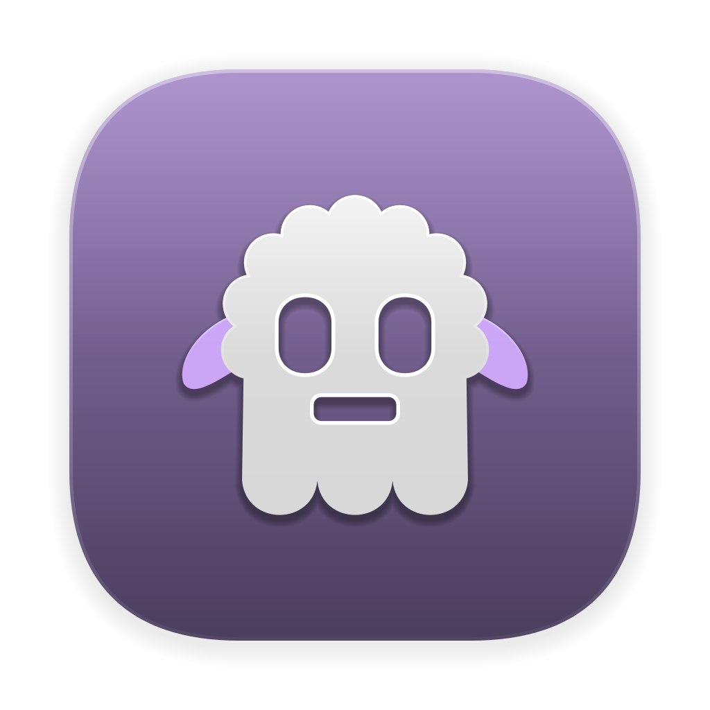

# herdr-fold



Your coding agents in herdr and its desktop app: Claude Code, Codex, OpenCode and GitHub Copilot CLI, their chats,
setup and usage, beside your files, git, GitHub issues and pull requests, on a Mac and on Linux, macOS and Windows
machines over SSH. One installer sets it all up, the sidebar and AI Sessions also install alone, and herdr's desktop
app gets it as a mod.

Created by [princesshu](https://github.com/princesshu).

[](
https://github.com/princesshu/herdr-fold/releases/latest)


## What you get

In the workspace's own order, the TUI's (herdr in Ghostty) and the Herdr app's alike unless a line says otherwise:

- **Spaces and sessions**: a space per repository, Claude, Codex, OpenCode or Copilot on the left; how long an agent
  has waited on you, AI Sessions with each chat's state, Cmd + D / Cmd + E through them: [Spaces](docs/usage.md#spaces).
- **The chat** (the Herdr app): Claude as a timeline, its questions answered in the prompt's place, its agent, model,
  mode, effort, context and cost in its bar; Start in a home space: [The chat](docs/app.md#the-chat).
- **Checkpoints**: a Claude chat's files back to how they were at one of its prompts, Claude saying first what changes,
  with one Undo: [in the app](docs/app.md#checkpoints), [in the TUI](docs/usage.md#checkpoints).
- **The dock**: Files, Search, Changes and, for a repository on GitHub, Issues, one view at a time beside the agent,
  above the terminal; folded, a rail of icons: [The sidebar](docs/sidebar.md), [the app's dock](docs/app.md#the-dock).

  

- **Commit and push** in one step, the message by Claude or Codex: [Commit and push](docs/usage.md#commit-and-push).
- **Pull requests**: the branch's own under Changes, a new one's title and body written by the agent, the repository's
  list beside Issues, and in the app a review with comments on its lines: [Pull requests](docs/usage.md#pull-requests).
- **Issues to the agent** in one key; the next commit closes the issue: [GitHub issues](docs/usage.md#github-issues).
- **Chats**: every space's Claude, Codex, OpenCode and Copilot chats, running and closed, a click or Cmd + Shift + R
  away, the chosen one's task list under it: [Chats](docs/usage.md#chats).
- **The Agent panel**: the agent's rules, skills, subagents, permissions, hooks, connectors and limits, each part
  changed from a form that shows the line it writes, with Undo: [The agent's harness](docs/harness.md).
- **Media connectors**: image, voice and video services (fal, ElevenLabs, FLUX, Runway…) added from the Agent panel;
  what they make shows in the preview with its prompt: [Media services](docs/harness.md#media-services).
- **The terminal** under the dock in every tab, on the space's machine; a file the agent names opens at its line in one
  key: [Opening a file the agent named](docs/usage.md#opening-a-file-the-agent-named).
- **The preview tab and editing files**: a picture, a PDF, a page or Markdown as it looks, a diff, a commit; a text file
  in an editor: [in the TUI](docs/usage.md#editing-files), [in the app](docs/app.md#editing-files).
- **Graph, Usage and Runs**: how the agent is wired, what the agents cost, what ran in the background:
  [Graph](docs/harness.md#the-graph), [Usage](docs/harness.md#the-usage-view), [Runs](docs/harness.md#the-runs-view).
- **Remote machines**: spaces on Linux, macOS and Windows machines over SSH: [Remote machines](#remote-machines).
- **Themes and the status line**: twelve color themes for Ghostty, herdr, the prompt and the app, Ghostty's app icon
  too: herdr-fold's logo, the sheep, in the theme's colors; a status line with the model, effort, context and limits,
  the same for Claude and Codex: [Themes](docs/themes.md), [The status line](docs/usage.md#the-status-line).
- **The Herdr app**: all of it as a layout of herdr's desktop app, alone or beside the TUI, with its own command palette
  and one Settings: [The Herdr app](docs/app.md).


## Requirements

- a Mac with Apple silicon and macOS 15 or later (what Homebrew supports; on an Intel Mac the install may get
  through, but it is not supported or tested);
- a coding agent, signed in: Claude Code, Codex, OpenCode or GitHub Copilot CLI (with a Copilot plan);
- Homebrew (the installer offers to install it). herdr 0.9.5 or newer, Ghostty and the rest come from the `Brewfile`.

## Install

From herdr's marketplace, with herdr already on your Mac:

```bash
herdr plugin install princesshu/herdr-fold
```

Once you confirm, the installer opens in a herdr tab of its own (at the next pane you focus). Or from the folder:

```bash
git clone https://github.com/princesshu/herdr-fold.git
cd herdr-fold
./install.sh
```

Either way it is the same installer with the same questions, the first one the TUI, the Herdr app or both. From the
folder, you can also double-click `install.command`. On macOS 15 and later, a downloaded copy may need System Settings →
Privacy & Security → **Open Anyway**. Enter always gives the default answer. When it is done, open Ghostty (herdr starts
in it; the **new** button under Spaces makes a space) or the Herdr app (herdr-fold's layout is there). The parts, the
questions, what each one changes, and the switches: [Installation](docs/installation.md).

## What it changes

- the settings of Ghostty, herdr and starship, and Claude Code's and Codex's status lines;
- one marked block in `~/.zshrc`, active only inside herdr panes;
- three herdr plugins of its own (the sidebar, AI Sessions, Spaces) and herdr's Claude and Codex integrations;
- in the Herdr app, herdr-fold's mod, layout, themes and keys.

Your own files are saved first, in `~/.local/state/herdr-fold/`. Your chats are never touched.
[More](docs/installation.md#what-changes-on-your-mac).

## Keys

| Key | What it does |
|---|---|
| Cmd + 1…9, Cmd + ↓ / Cmd + ↑ | jump to a space; next / previous space |
| Cmd + → / Cmd + ← | next / previous pane: the agent, the sidebar, the terminal |
| Cmd + T / Cmd + R | next / previous tab |
| Cmd + D / Cmd + E | next / previous session |
| Cmd + Shift + U | mark the agent unread, to come back to |
| Ctrl + B, then Shift + N / Shift + M | new space / add a machine |
| Cmd + Shift + C | commit and push |
| Cmd + Shift + L | open a file the agent named, at its line |
| Cmd + Shift + R | find a chat in the sidebar's Chats |
| Cmd + Shift + E | show / hide the sidebar and terminal (Cmd + Option + B: the sidebar folded to its icons or open) |
| Cmd + Shift + G / Cmd + Shift + I | the sidebar's Changes / Issues |
| Cmd + W | close the tab |
| Cmd + K, then Cmd + T | pick a theme |

In typing, Ctrl + A / Ctrl + E go to the start or the end of the line. All keys, the Herdr app's too, and how to change
them: [Keys](docs/keybindings.md).

## Remote machines

Step 8 of the installer connects any machine the Mac reaches over SSH: from `~/.ssh/config`, by address, from a
Tailscale or NetBird network where one is installed, or from those announcing SSH on the local network; Ctrl + B, then
Shift + M (Add a machine) adds one later. The agents, the sidebar and the terminal run on the machine, and keep running
when the Mac sleeps; the Mac shows them: [Remote machines](docs/remote-machines.md).

## Updating

Get the newer `herdr-fold` folder (`git pull`, or replace the folder) and run `./install.sh` again. It asks one
question, Enter keeps your earlier choices, then it updates what changed, removes what is no longer needed (what you
changed saved first) and updates the connected machines. Installed from herdr's marketplace: `herdr plugin update
herdr-fold`, and the installer opens in a herdr tab again. The sidebar's More (a dot) and the Herdr app's status
bar say when a newer version is out, a look once a day at most
([how, and how to turn it off](docs/installation.md#a-newer-version)).

## Uninstall

```bash
./uninstall.sh                  # this Mac: the TUI, the Herdr app or both
./machines.sh remove alpha      # one remote machine
```

Installed from herdr's marketplace, the folder is `~/.local/share/herdr-fold`. What goes and what stays:
[Uninstall](docs/uninstall.md).

## Troubleshooting

Each symptom with its fix, in its message's own words: [Troubleshooting](docs/troubleshooting.md). The sidebar and the
terminal gone: Cmd + Shift + E brings them back. Claude's status line empty: `/exit`, then `claude --continue`, and
trust the folder.

## Documentation

- [Installation](docs/installation.md): the questions, what changes, the switches
- [Using it](docs/usage.md): spaces, sessions, the status line, commit and push, pull requests, issues, chats,
  checkpoints, editing files
- [The agent's harness](docs/harness.md): the Agent panel, each edit and what it writes, the graph, Usage and Runs
- [Keys](docs/keybindings.md): every key, and remapping
- [Remote machines](docs/remote-machines.md): Linux, macOS and Windows machines
- [Themes](docs/themes.md): the twelve themes and the picker
- [The sidebar](docs/sidebar.md): the TUI's right column, its row of views and its rail
- [The Herdr app](docs/app.md): herdr-fold's layout for herdr's desktop app: the chat, the dock, the Agents tab,
  Settings; its parts in each state: [Styleguide](docs/styleguide.md)
- [Translating](docs/translating.md): the installer in another language
- [How it is built](docs/architecture.md): the files and the installer's records
- [Troubleshooting](docs/troubleshooting.md), [Uninstall](docs/uninstall.md)

## Contributing

Tests, code rules and the privacy checks: [CONTRIBUTING.md](CONTRIBUTING.md).

## Security

Report a vulnerability privately, as [SECURITY.md](SECURITY.md) describes.

## Attribution and trademarks

The themes' colors and the programs it installs come from other projects:
[THIRD_PARTY_NOTICES.md](THIRD_PARTY_NOTICES.md). Claude Code, Codex, herdr, Ghostty and the other names are trademarks
of their owners; herdr-fold is not affiliated with them.

## Author and credits

herdr-fold was created by [princesshu](https://github.com/princesshu): the installer, the settings, the themes and the
three herdr plugins that put the programs below together into one setup. If you use or adapt it, please credit it with
a link to [github.com/princesshu/herdr-fold](https://github.com/princesshu/herdr-fold).

It builds on programs made by others, which it installs but does not contain: [herdr](https://github.com/herdrdev/herdr)
by herdrdev, [Ghostty](https://github.com/ghostty-org/ghostty), [starship](https://github.com/starship/starship),
Claude Code by Anthropic and Codex by OpenAI. Their licenses, and where the themes' colors come from:
[Third-party notices](THIRD_PARTY_NOTICES.md).

## License

[MIT](LICENSE), copyright 2026 [princesshu](https://github.com/princesshu).
