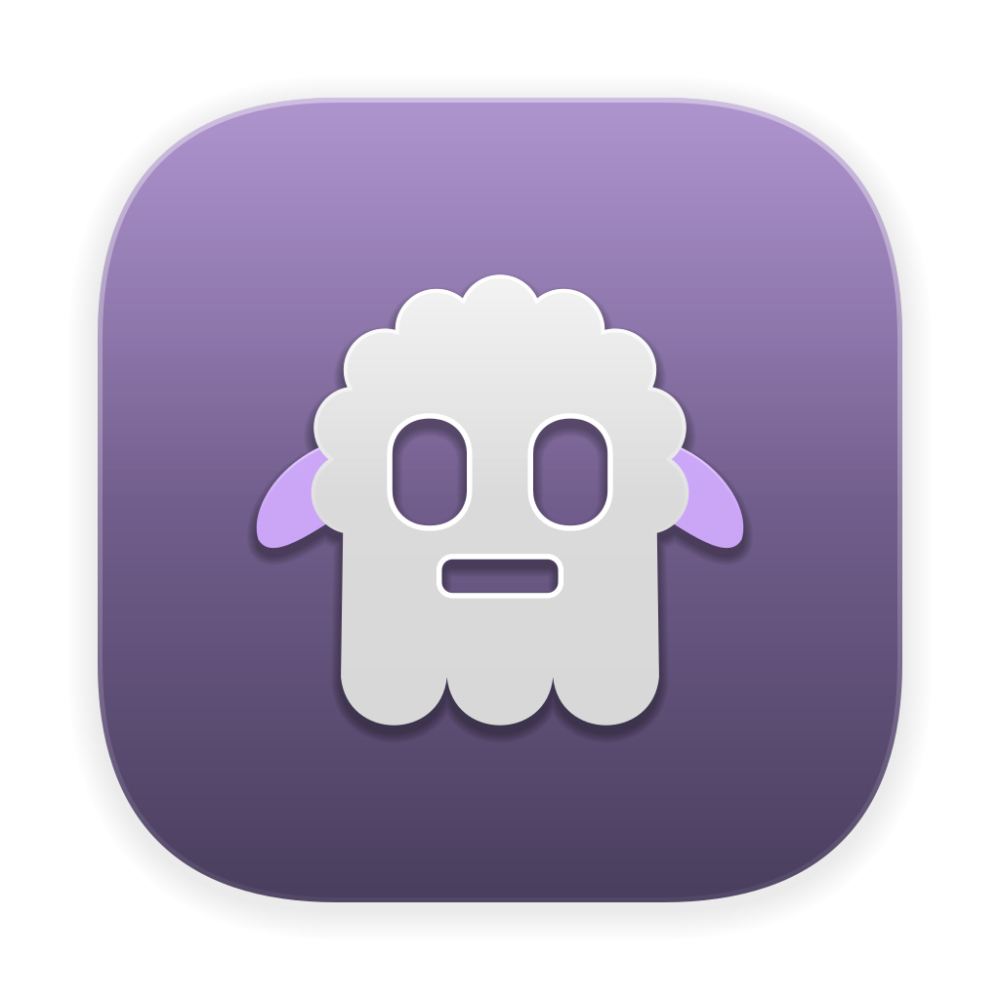

# herdr-fold



Files, search, git and GitHub issues, AI sessions and conversations, AI commit messages and themes for Claude Code and
Codex in herdr and Ghostty, on a Mac and on Linux, macOS and Windows machines over SSH. One installer sets up all of
it; the sidebar and AI Sessions also install alone; herdr's desktop app gets it as a mod, alone or beside the TUI.

Created by [princesshu](https://github.com/princesshu).

[](
https://github.com/princesshu/herdr-fold/releases/latest)


## What you get

- One workspace per repo: Claude or Codex on the left; on the right, a sidebar (Files, Search, Changes (git) and,
  for a repo on GitHub, Issues) above a terminal. An issue goes to the agent in one key, and the next commit
  closes it; a file the agent names opens at its line in one key too, and a picture or a PDF shows as it looks.

  

- A Conversations column between them: every workspace's Claude and Codex conversations, running and closed, one
  click away; it collapses to a rail.
- AI Sessions in herdr's sidebar, with each conversation's state, and in the Spaces list how long an agent has waited
  on you. Cmd + D / Cmd + E step through the sessions, Cmd with the arrows through the workspaces and the panes, even
  while you type.
- Commit and push in one step, with a message Claude or Codex writes and you approve.
- Twelve color themes for Ghostty, herdr and the prompt, Ghostty's app icon too: herdr-fold's logo, the sheep, in the
  theme's colors. A status line with the model, effort, context with its window size and limits, the same for Claude
  and Codex.
- Workspaces on Linux, macOS and Windows machines over SSH; the agents keep running there when the Mac sleeps.
- In herdr's desktop app too, as a layout of its own: the sidebar's four views beside the tab and its own terminal
  under them, Spaces with the waits and the conversations on the left, the twelve themes; on remote machines alike:
  [The Herdr app](docs/app.md).


## Requirements

- a Mac with Apple silicon and macOS 15 or later (what Homebrew supports; on an Intel Mac the install may get
  through, but it is not supported or tested);
- Claude Code and/or Codex, signed in;
- Homebrew (the installer offers to install it). herdr 0.9.5 or newer, Ghostty and the rest come from the `Brewfile`.

## Install

From herdr's marketplace, with herdr already on your Mac:

```bash
herdr plugin install princesshu/herdr-fold
```

Once you confirm, the installer opens in a herdr tab of its own (at the next pane you focus). Or from the folder:

```bash
git clone https://github.com/princesshu/herdr-fold.git
cd herdr-fold
./install.sh
```

Either way it is the same installer with the same questions, the first one the TUI, the Herdr app or both. From the
folder, you can also double-click `install.command`. On macOS 15 and later, a downloaded copy may need System Settings
→ Privacy & Security → **Open Anyway**. Enter always gives the default answer. When it is done, open Ghostty (herdr
starts in it; the **new** button under Spaces makes a workspace) or the Herdr app (herdr-fold's layout is there).

The parts, the questions, what each one changes, and the switches: [Installation](docs/installation.md).

## What it changes

- the settings of Ghostty, herdr and starship, and Claude Code's and Codex's status lines;
- one marked block in `~/.zshrc`, active only inside herdr panes;
- three herdr plugins of its own (the sidebar with the Conversations column, AI Sessions, the tab layout), and
  herdr's Claude and Codex integrations;
- in the Herdr app, herdr-fold's mod, layout, themes and keys.

Your own files are saved first, in `~/.local/state/herdr-fold/`. Your conversations are never touched.
[More](docs/installation.md#what-changes-on-your-mac).

## Keys

| Key | What it does |
|---|---|
| Cmd + 1…9 | jump to a workspace |
| Cmd + ↓ / Cmd + ↑ | next / previous workspace |
| Cmd + → / Cmd + ← | next / previous pane: the agent, Conversations, the sidebar, the terminal |
| Cmd + T / Cmd + R | next / previous tab |
| Cmd + D / Cmd + E | next / previous session |
| Cmd + Shift + U | mark the agent unread, to come back to |
| Ctrl + B, then w | the Spaces list: W / S move, Enter switches |
| Ctrl + B, then Shift + N | new workspace |
| Cmd + Shift + C | commit and push |
| Cmd + Shift + L | open a file the agent named, at its line |
| Cmd + Shift + R | find a conversation in the Conversations column |
| Cmd + Shift + E | show / hide the sidebar and terminal |
| Cmd + Shift + H | collapse / open the Conversations column |
| Cmd + Shift + O | restore the panels closed in the tab |
| Cmd + Shift + G / Cmd + Shift + I | the sidebar's Changes / Issues |
| Cmd + A | select the whole text of the sidebar's field you are in |
| Cmd + F | search the Claude conversation |
| Cmd + W | close the tab |
| Cmd + K, then Cmd + T | pick a theme |

In typing, Ctrl + A / Ctrl + E go to the start or the end of the line. All keys, and how to change them:
[Keys](docs/keybindings.md).

## Remote machines

Step 8 of the installer connects machines from `~/.ssh/config`, your Tailscale network, or by address; Ctrl + B, then
Shift + M adds one later. The agents, the sidebar and the terminal run on the machine; the Mac shows them.
[Remote machines](docs/remote-machines.md).

## Updating

Get the newer `herdr-fold` folder (`git pull`, or replace the folder) and run `./install.sh` again. It asks one
question, Enter keeps your earlier choices, then it updates what changed, removes what is no longer needed (saved first)
and updates the connected machines. Installed from herdr's marketplace: `herdr plugin update herdr-fold`, and the
installer opens in a herdr tab again. The sidebar and the Herdr app say when a newer version is out, once a day at most
([how, and how to turn it off](docs/installation.md#a-newer-version)).

After `brew upgrade herdr`, the herdr running in the background keeps the old version: `herdr server live-handoff`
switches to the new one without stopping your agents.

## Uninstall

```bash
./uninstall.sh                  # this Mac: the TUI, the Herdr app or both
./machines.sh remove alpha      # one remote machine
```

Installed from herdr's marketplace, the folder is `~/.local/share/herdr-fold`.

[Uninstall](docs/uninstall.md).

## Troubleshooting

| Symptom | Fix |
|---|---|
| The sidebar and the terminal are gone | Cmd + Shift + E: hidden or closed, it brings them back |
| Claude's status line is empty | trust the folder: `/exit`, then `claude --continue`, and answer yes |
| A machine will not connect | the installer says why and what to do; for a key it does not take, try `ssh dev@alpha.example` by hand, and for a key with a passphrase, `ssh-add --apple-use-keychain` |
| Text selected from a reply pastes as plain text | reopen Ghostty (Cmd + Q, then open it) |

More: [Troubleshooting](docs/troubleshooting.md).

## Documentation

- [Installation](docs/installation.md): the questions, what changes, the switches
- [Using it](docs/usage.md): workspaces, sessions, conversations, GitHub issues, commit and push, copying, the status
  line, restarting
- [Keys](docs/keybindings.md): every key, and remapping
- [Remote machines](docs/remote-machines.md): Linux, macOS and Windows machines
- [Themes](docs/themes.md): the twelve themes and the picker
- [The sidebar](docs/sidebar.md): Files, Search, Changes and Issues, as herdr-fold uses them
- [The Herdr app](docs/app.md): herdr-fold's layout for herdr's desktop app, its views, themes and machines; its
  parts in each state: [Styleguide](docs/styleguide.md)
- [Troubleshooting](docs/troubleshooting.md)
- [Translating](docs/translating.md): the installer in another language
- [How it is built](docs/architecture.md): the files and the installer's records
- [Uninstall](docs/uninstall.md)

## Contributing

Tests, code rules and the privacy checks: [CONTRIBUTING.md](CONTRIBUTING.md).

## Security

Report a vulnerability privately, as [SECURITY.md](SECURITY.md) describes.

## Attribution and trademarks

The themes' colors and the programs it installs come from other projects:
[THIRD_PARTY_NOTICES.md](THIRD_PARTY_NOTICES.md). Claude Code, Codex, herdr, Ghostty and the other names are trademarks
of their owners; herdr-fold is not affiliated with them.

## Author and credits

herdr-fold was created by [princesshu](https://github.com/princesshu): the installer, the settings, the themes and the
three herdr plugins that put the programs below together into one setup. If you use or adapt it, please credit it with
a link to [github.com/princesshu/herdr-fold](https://github.com/princesshu/herdr-fold).

It builds on programs made by others, which it installs but does not contain: [herdr](https://github.com/herdrdev/herdr)
by herdrdev, [Ghostty](https://github.com/ghostty-org/ghostty), [starship](https://github.com/starship/starship),
Claude Code by Anthropic and Codex by OpenAI. Their licenses, and where the themes' colors come from:
[Third-party notices](THIRD_PARTY_NOTICES.md).

## License

[MIT](LICENSE), copyright 2026 [princesshu](https://github.com/princesshu).
