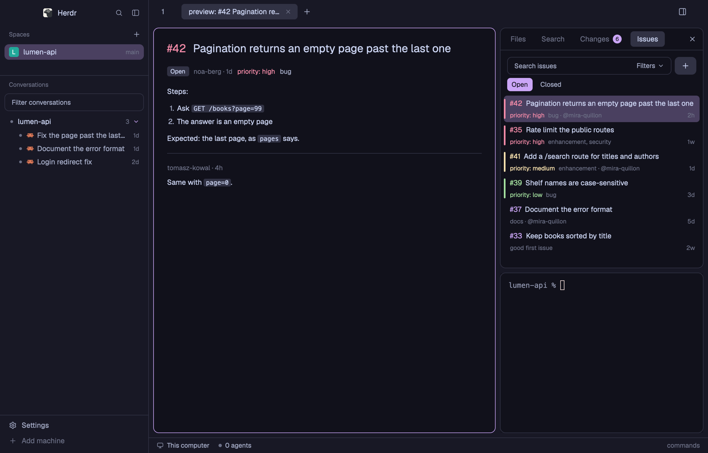

# herdr-fold

herdr-fold's layout for the Herdr app: herdr-fold's sidebar from herdr's TUI (Files, Search, Changes, Issues) as a
right panel beside the tab, each tab's own terminal under it, and on the left a Spaces list that says how long an
agent waits on you and every conversation of this Mac's spaces. A file, an image, a diff, a commit or an issue opens
in the space's preview tab. Twelve themes come with it.

## What you see

- Left, the sidebar, 268 px (76 to 480; folded, a 76 px dock): the app's own brand row (46 px), then Spaces and
  Conversations sharing the rest (each 90 px at least, the edge between them dragged), the app's footer (69 px).
- Top, 42 px: herdr-fold's own tab bar, the space's tabs as pills 28 px high, radius 6, + after the last one, the
  right panel's toggle at the end; off macOS the window's buttons too.
- Middle, the active tab's panes, 8 px apart and from the edges, radius 10, a 1 px border, the focused one in the
  accent color; terminals in Menlo 13 (padding 14 by 12).
- Right, the panel, 368 px (76 to 900): a panel group of Files, Search, Changes (its changed files' count in a round
  badge) and, for a repository on GitHub, Issues, as tabs on its 40 px header; under it (two fifths of the height,
  120 px at least) the tab's own terminal.
- Bottom, the app's status bar, 28 px.
- Colors are the theme's roles (canvas, chrome, background, border, accent, the ansi colors for states); fonts the
  app's, code in Menlo.

## How it behaves

- An agent's state: working, blocked (waiting on you), done and idle, in herdr's colors, on its tab (a spinner while
  it works), on its space's row and on its conversation; a space where one waits says `waiting 12m` in yellow, the
  longest wait when several do, until you come back to it after leaving it.
- Spaces: a click shows a space, a drag reorders a machine's spaces, a right click opens the app's menu for it; with
  another machine known, a head per machine that folds its spaces.
- Conversations: by space, the running ones marked; a click goes to a running one or reopens a closed one in a new
  tab (`claude --resume`, `codex resume`); right click: Open, Copy conversation, Rename, Archive.
- Changes: the repository row (branch, sync and a menu), the message field with the AI button beside it (Claude or
  Codex writes the message, the field saying who meanwhile), Commit with its modes (Commit, Commit & Push, Commit &
  Sync), staged and unstaged files with stage, unstage and discard on hover, the Graph of the last 20 commits. The
  sync is ↻, the menu ⋯, the AI button ✦.
- Files: the folder as a tree with git's marks; a click opens a file in the preview tab (an image or a PDF drawn,
  a PDF paged), a right click New File, New Folder, Rename, Copy Path, Move to Trash, Open in Browser.
- Search: ripgrep (else git grep) as you type, with case, word and regex switches. Issues: by priority, filters,
  hand one to the tab's agent, reply, assign, close.
- The panel's toggle or Cmd + Shift + G folds the panel to a rail of icons; a press floats a view beside it. The
  left sidebar folds the same way.
- Keys (`layout:herdr-fold`): Cmd + Shift + G the panel, Cmd + Shift + C commit and push, Cmd + Shift + I Issues,
  Cmd + Shift + R Conversations, Cmd + Shift + U mark the agent unread.

## Built from

- `layouts/herdr-fold.json`: a row of `sidebar` (column: `brand` block, `sidebar-lists` column of `spaces` and
  `conversations` blocks, `sidebar-footer` block) and `work` (column: `top` row of `sidebar-trigger` and `tabs`
  blocks, `work-body` row of `main` (the active tab) and `fold-panel` (column: `fold-panel-body` stack of `files` and
  `changes` with a 40 px header, `fold-terminals` stack, `panel-rail` block), `status` block). Theme `herdr-fold`
  (or `herdr-fold-<theme>` from herdr-fold's installer), font Menlo 13, no titlebar, traffic lights at 12, 16.
- `mods/herdr-fold/`, one mod drawn by its `props.part`: `spaces`, `conversations`, `trigger`, `tabs`, `panel-tabs`,
  `files`, Changes (no part), `terminal` (the stack's header), `none`, `rail`; as overlays `float`, `float-head`,
  `menu`; as tabs `preview` and `styleguide`. The shipped `workspace-chrome` (brand, footer) and `workspace-status`.
- herdr functions: `spaces`, `panes`, `agents`, `knownAgents`, `focused`, `machines`, `terminals`, `layout`,
  `settings`, `theme`, `props`, `shared` / `setShared`, `readTextFile`, `watchFolder`, `exec`, `hc`, `home`, `run`,
  `nextCommand`, `openOverlay` / `closeOverlay`, `updates`, `window`; commands `tab.*`, `space.*`, `layout.*`,
  `mod.open`, `agent.focus`, `app.settings`, `window.*`.
- Programs: Python 3 on the space's machine runs herdr-fold's data layer (`helper.js`: git, gh, ripgrep, Claude Code
  or Codex for a message; on the Mac sips and swiftc for pictures and PDFs); `hc` runs the tabs' terminals and the
  message writer as a job of its own.
- Art: Lucide's icons for the views, Catppuccin Icons' for file types, in `mods/herdr-fold/icons/`.

## Watch out

- It runs programs (`exec`, `hc`): git, gh, ripgrep and Python 3 on the space's machine; a commit message sends the
  staged diff to Claude Code or Codex there. It reads the repository, this Mac's Claude and Codex conversation files,
  and gh's GitHub sign-in.
- `image()` takes a path from the app's home: pictures are made in `herdr-fold-pictures/` there, a day at most.
- A transition is kept by its element's id: two lists drawn with the same ids share one.
- `.tooltip()` cannot choose its side: a tip at the right edge is a `HoverCard` anchored to open left.
- `overflow_x_scrollbar()` grows its container; `overflow_x_scroll()` does not.
- A running app keeps shared values and writes them back: close it before taking them off.
- Many tabs of the mod opened and closed, or many reloads, can run the script engine out of memory: the app then
  draws the last good frame; quitting and opening it again helps.
- Without Python 3 and git on a machine, its spaces show nothing; Issues need gh signed in there.

## Done when

- `herdr-app check mods/herdr-fold` passes, `layout.switch --name herdr-fold` shows it and `herdr-app status` lists
  no errors.
- In a repository with changes: Changes lists them, the AI button writes a message (the field saying who writes it),
  Commit & Push commits and pushes, and the Graph shows the new commit.
- Search finds a word in the space's folder; a hit's file shows at its line.
- In a repository on GitHub, Issues lists the issues by priority, and To agent hands one to the tab's Claude.
- A file clicked in Files opens in the preview tab; an image or a PDF is drawn there.
- Spaces says `waiting` beside a space whose agent waits on you; Conversations reopens a closed conversation.
- Cmd + Shift + G folds the panel to its rail and opens it again; the tab's terminal runs on the space's machine.
