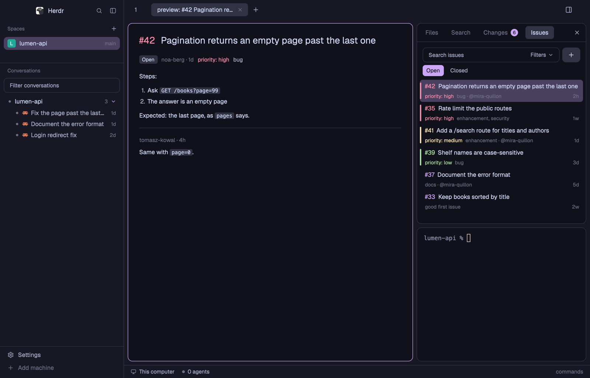

# herdr-fold

herdr-fold's layout for the Herdr app: your coding agents in every space (Claude Code in a chat view; Codex, OpenCode
and GitHub Copilot CLI in their own terminals), beside them one panel for Files, Search, Changes, Issues and the Agent
view, and twelve themes.

## What you see

- Top, across the whole window, 36 px with a hairline under it, on the window's level: the title row, the traffic
  lights in it on macOS (18 px in, on its middle line), elsewhere the window's own buttons at its end; at the window's
  centre the command field, 300 by 25 px, rounded 6 with a 1 px border: ⌘ (the palette's mark; off macOS its search),
  the shown space's name faint as a placeholder (12 px, dim) and the palette's key at its end (11 px, dim). The
  command palette opens onto it: 600 px on the window's centre, 8 px under its top, its field over the title row's,
  under a hairline the app's commands in the app's groups, each with its key as caps at its end, the first lit.
- Left, under it, the sidebar, 268 px (76 to 480; folded, a 76 px dock): its head (42 px, on the tab bar's line:
  Herdr's mark and name at its start, 16 px in, Go to space or tab and the sidebar's toggle at its end), then Spaces
  taking the rest, its foot (69 px: Settings, Add machine…, as the app's own foot).
- Beside it, 42 px: herdr-fold's own tab bar, the space's tabs as pills 28 px high, radius 6, then + (a new agent: New
  chat) and >_ (New terminal: the machine's shell); at the end, over the dock, Chats (✦, a dot while chats wait on
  you), More (⋯) and » (« while the dock is a rail), » in the row of the left sidebar's own toggle.
- Middle, the active tab's panes, 8 px apart and from the edges, radius 10, a 1 px border, the focused one in the
  accent color; terminals in herdr-fold Mono 13, as the TUI's (padding 12 on every side).
- Right, the dock, 368 px (76 to 900): one card (five sevenths of the height), its top level with the tab's, rounded 10
  with a 1 px border: on top its views' text tabs, 8 px round them and a hairline under them (45 px): Files, Search,
  Changes, Issues (a repository on GitHub), Agent (its agent's icon before its name), each as wide as its name, 28 px
  high, radius 8, the shown one on a raised pill; Changes' changed files in a small round accent badge (18 px) after its
  name, short when large (1.2k, 18k); narrower, the last tabs left out, never the shown one. Under it the view chosen,
  or the Chats list in its place, 12 px inside on every side. Then, 8 px under it, the tab's own terminal on a card of
  its own (two sevenths at first, 120 px at least; the boundary between the two drags). The dock is open or its rail,
  hidden by Cmd + Shift + E alone; folded, the tab's terminal stands under the tab instead, the centre's width, 240 px
  high at first (then as dragged), 8 px under it.
- Bottom, herdr-fold's status bar, 28 px, on the side's level under a hairline, 16 px in and its items 16 apart, 12 px
  text in the captions' tone: the shown space's machine (This computer) and branch, the agents behind a 6 px dot, and at
  the end an update Herdr has ready (a green dot and `Update ready: herdr-core 0.1.21`).
- Colors are the theme's roles (canvas, chrome, surface, popover, border, accent, the ansi colors for states), drawn as
  the TUI is: every card on the terminals' background, the window, its bars and the left sidebar in herdr's sidebar
  color (one color in most themes, the cards parted by their 1 px border), the popovers a step lighter; fonts the
  app's, code in herdr-fold Mono, the mod's own (`mods/herdr-fold/fonts/`).

## How it behaves

- An agent's state: working, blocked (waiting on you), done and idle, in herdr's colors, on its tab (a spinner while
  it works), on its space's row and on its chat; a space where one waits says `waiting 12m` in yellow, the
  longest wait when several do, until you come back to it after leaving it. A chat tab whose Claude asks something
  (its card in the prompt's place) says so the same way, its tab blocked, Chats' dot marking it, with the app's
  blocked sound and, while you look elsewhere, a toast that shows its tab; Claude asking in its own terminal (a new
  folder's trust question) shows that terminal under the chat until it is answered.
- The title row drags the window (a double click maximizes it); its field, or Cmd + Shift + P (`herdr-fold.palette`
  in the layout's keys, in place of the app's `app.palette`: one palette), opens herdr-fold's command palette onto it,
  the field drawn empty while it is open; its tip `Commands`, its key the palette's as bound (`keys()`: the layout's own
  section over global). The palette lists the app's commands (`commands()`, `layouts()`) as the app's palette names
  and groups them, then herdr-fold's own in a group of its name (`PALETTE_OWNED`), each with its key as it works in the
  layout; typing finds them as the chat's / menu finds its rows,
  the best first; Enter runs the lit one (`run`), ↑ ↓ move it, Esc, a press beside or the key again closes it.
  Narrow, the field narrows, and under 160 px it is its mark alone, the key in its tip.
- The status bar says the agents in words, those waiting on you first (`1 of 3 agents waiting for you`, the dot
  yellow), else those working (the dot in the accent), else how many (`1 agent`, `2 agents`). While Herdr has an update
  ready (`updates()`: herdr-core's, unless a package manager owns it, or the app's), its item's press runs
  `app.update_core` (the terminals keep running; a spinner meanwhile) or `app.update` (a restart), its tip saying
  which; it is the layout's one sign of it.
- Spaces: a click shows a space, a drag reorders a machine's spaces, a right click opens the app's menu for it; with
  another machine known, a head per machine that folds its spaces.
- Chats: Chats at the tab bar's end shows them in the view's place, its filter taking the keys, as the TUI sidebar's
  does: by space (a folder with no space open under its name), the running ones marked; a click goes to a running one or
  reopens a closed one in a new tab (a Claude chat as a chat tab; with Open agents in: Terminal, and Codex's,
  OpenCode's and Copilot's always, `claude --resume`, `codex resume`, `opencode --session`, `copilot --resume`) and the
  view comes back, as with Chats again, Esc or a tab; right click: Open, Copy chat, Rename, Archive, Delete… (asked in
  its row, then its file to the Trash; never an OpenCode or Copilot chat's, kept in the agent's own store).
- New agents: + after the tabs (Cmd + N) opens a new chat with the agent used last that a chat draws: New chat and
  `in <space> · <branch>` in its middle, the prompt with the agent's chip; the chip's list (a filter, the recent first,
  not installed dim, `terminal` for one no chat draws) picks another, one marked terminal opening in a terminal tab in
  the chat's place; the first message starts the agent. A space on this Mac that holds shells alone (a new one too)
  gets an empty chat as its first tab the first time it shows, once. Settings' Open agents in: Terminal makes every
  way in (+, Chats, Issues' To agent, a new space) open the agent's CLI in a terminal tab instead.
- The chat: Claude's chat as a timeline from its session file, a call and its result one row; what Claude waits on a
  card in the prompt's place, its answers numbered; the task list a strip over the prompt, `3 of 5 done`; a prompt's
  checkpoint, `Restore files to here`, Claude's dry run first and one Undo after. A home space opens the Start tab (Open
  project…, the folders of the chats so far); an empty chat whose agent is not signed in lists every installed agent
  with Sign in or Use.
- The model chip in a chat's bar (Opus 5.5 High, the level dimmer; in a narrow chat the model alone) opens the
  agent's models upward, a line each, the one in use checked; the mode chip opens the Modes panel (⇧ + tab to switch):
  the modes, Effort with a dot slider and the level's name, Ultracode with a switch (Claude only). Picked before the
  agent runs, they go with its start (`--model`, `--permission-mode`, `--effort`, its settings); after, as `/model`,
  `/effort`, `/effort ultracode` and shift+tab typed to it.
- The context meter in a chat's bar (the ring and `context 34%`) opens the Context panel: the use in numbers, a bar of
  what fills it (rules, skills, connectors, the rest), what the chat cost, Compact and Show all in Agent. A "/" typed
  in the prompt opens the / menu over it: Export the chat, the folder's skills with their source tags (Project,
  Global, a plugin's), Claude's commands; what follows the "/" filters it, Enter picks the lit row.
- Changes: the repository row (branch, sync and a menu), under it the branch's pull request or Create pull request…, the
  message field with the AI button beside it (Claude or Codex writes the message, the field saying who meanwhile),
  Commit with its modes (Commit, Commit & Push, Commit & Sync), staged and unstaged files with stage, unstage and
  discard on hover, the Graph of the last 20 commits. The sync is ↻, the menu ⋯, the AI button ✦.
- Files: the folder as a tree with git's marks; a click opens a text file in an editor tab of its own (Cmd + S saves in
  place, Cmd + F finds, a draft kept so closing asks nothing), anything drawn in the preview tab (an image or a PDF, a
  PDF's pages scrolled, a page, Markdown, audio, a video), a right click New File, New Folder, Rename, Copy Path, Move
  to Trash, Open in Browser (a page, a PDF or a picture on this Mac), New space (a folder).
- Search: ripgrep (else git grep) as you type, with case, word and regex switches. Issues: by priority, filters, hand
  one to the tab's agent (none there: a new one, as + starts it), reply, assign, close; Pull requests beside them, a
  press opening one's review in the preview tab (comments on a line, Approve, Request changes).
- Agent: what the space's agent (Claude, Codex, OpenCode or Copilot) starts with in the folder: a head line (`Opus 5.5 ·
  High · starts at 34.2k of 1M`) and a bar of what loads, then Usage, Subagents, Rules, Skills, Permissions (with its
  Hooks) and Connectors as layers with their counts and costs, a failed server or one to sign in to first and as a chip
  on the head line (a press chooses its row; a dot on the Agent tab and the rail meanwhile), a filter from the head's
  search. A press chooses a row: its properties under the layers, the label left and the value right, with Open (its
  file in the preview tab), Show in graph and, on a failed server, Retry (`claude mcp get`). A row that can be changed
  holds its form there (the mode, the model and effort, the sandbox, a permission rule, a switch for a skill, a
  subagent, a connector or every hook): the layer to save in, the line the save writes, Save, then Undo at the panel's
  foot; `helper.js`'s `HARNESS` plans and writes it. A chat's Context panel leads here (Show all in Agent).
- Agents: a tab of the main area, one a space, with the agent's graph: three columns (what goes in, the agent with its
  subagents, what they use), an edge solid, dashed, waiting or failed, the permission and the hook as gates on it. A
  press chooses a node (its properties at the canvas's foot), a node drags and stays where it is let go, a double click
  beside the nodes lays them out again. The Agent panel's Show in graph opens it on a row's node. Its other views:
  Usage, the report of what the agents used and cost (the period and the agent, a summary, each day by model, a month
  against its budget, the projects, chats and models, Export CSV), and Runs, what the agents ran in the background
  (Claude's background sessions, Codex's `codex exec` runs and cloud tasks), with New run.
- A tab shows its view; each space keeps its own, a new one starting on Files, Issues coming back on GitHub. More shows
  or hides each view (one always stays) and opens Settings at About; the sidebar's Settings and Cmd + , open the one
  Settings (General: agents open in a chat or a terminal; Notifications: an agent waiting on you; About: the version,
  the update check, What's new; under Application the app's own sections, each opening the app's Settings there; a newer
  herdr-fold is the status bar's item); » at the tab bar's end folds the dock to a rail of icons, the views, then the
  terminal, and « in the same place opens it again; a press floats a view beside the rail, its icon lit (pressed again,
  Esc, × or a press beside it closes it; another icon, «, More or ✦ closes it and acts at once; Esc in its field is the
  view's first), as tall as last dragged, Chats from the tab bar floats its list there, and Terminal shows or hides the
  tab's terminal under the tab, lit while it shows. Let go after a drag, a side under 160 px is its rail, and a rail
  dragged 24 px wider opens. The left sidebar folds the same way, to Spaces, its toggle in its head over the rail; both
  rails on the side's level.
- Keys (`layout:herdr-fold`): Cmd + Shift + G Changes, Cmd + Shift + F Search, Cmd + Shift + I Issues, each shown, the
  dock opened; Cmd + Shift + C commit and push, Cmd + Shift + R Chats and back, Cmd + Shift + U mark the agent unread,
  Cmd + N a new agent (a chat, as +), Cmd + , Settings, Cmd + B the left sidebar folded or opened (never hidden),
  Cmd + Option + B the right dock the same, Cmd + Shift + E the dock hidden or shown, Cmd + Shift + O Restore panels,
  Cmd + Shift + L a file the terminal's output names; herdr-fold's TUI keys for moving: Cmd + 1…9 and Cmd + ↓ / ↑
  spaces, Cmd + T / R tabs, Cmd + D / E agents, Ctrl + B then 1…9 a tab, Ctrl + B then w Go to space or tab, Ctrl + B
  then Shift + N a new space in a folder, Ctrl + B then Shift + M Add machine…, Cmd + K then Cmd + T the theme. In the
  `terminal` section, every layout: Shift + Enter sent as Option + Enter (a new line in Claude Code).

## Built from

- `layouts/herdr-fold.json`: a column (it never drags) of the `title` block (36 px, `window_drag`) and the
  `workspace` row of `sidebar` (column: `sidebar-head`, `fold-spaces` and `sidebar-footer` blocks) and `work` (column:
  `top` row of the `tabs` block, `work-body` row of `fold-center` (column: `main`, the active tab,
  and while the dock is a rail the `fold-terminals` stack) and `fold-panel` (column: the `fold-views` stack of `files`,
  `search`, `changes`, `issues`, `agent` and `fold-chats`, the tabs its header, the `fold-terminals` stack, `panel-rail`
  block), `status` block). Theme `herdr-fold` (or `herdr-fold-<theme>` from herdr-fold's installer), font herdr-fold
  Mono 13, no titlebar, traffic lights at 17, 9.5 (their circles 18 px in, on the title row's middle line).
- `mods/herdr-fold/`, one mod drawn by its `props.part`: `title` (the title row), `head` (the sidebar's head, its toggle
  over the dock while folded), `footer` (the open sidebar's foot), `spaces` (folded, its dock), `tabs` (with Chats and
  More at its end), `dock-head` (the views' tabs, their stack's header), `files`, a view (no part, its `view`:
  `changes`, `search`, `issues`, `agent`), `chats` (the list in the view's place), `terminal` (the terminals' stack's
  header), `none`, `rail`, `status` (the window's status bar); as overlays `float`, `menu` (a filter on top for a new
  chat's agents), `palette` (a popup with no frame at the window's top), `settings` (a dialog); as tabs `preview`,
  `editor`, `chat`, `start`, `agents` and `styleguide`. Herdr's mark from the app's own `frame/welcome/herdr.png`.
- herdr functions: `spaces`, `panes`, `agents`, `knownAgents`, `focused`, `machines`, `terminals`, `layout`,
  `settings`, `theme`, `props`, `shared` / `setShared`, `readTextFile`, `watchFolder`, `exec`, `hc`, `home`, `run`,
  `nextCommand`, `openOverlay` / `closeOverlay`, `notify`, `playSound`, `updates`, `keys`, `commands`, `layouts`,
  `window`; commands `tab.*`, `space.*`, `layout.*`, `terminal.keep` / `terminal.park`, `mod.open`, `agent.focus`,
  `app.settings`, `app.update`, `app.update_core`, `window.*`, and from the palette any the app lists.
- Programs: Python 3 on the space's machine runs herdr-fold's data layer (`helper.js`: git, gh, ripgrep, Claude Code
  or Codex for a message; on the Mac sips and swiftc for pictures and PDFs); `hc` runs the tabs' terminals and the
  message writer as a job of its own.
- Art: Lucide's icons for the views, Catppuccin Icons' for file types, SVG Logos' for a connector's service, in
  `mods/herdr-fold/icons/`.

## Watch out

- It runs programs (`exec`, `hc`): git, gh, ripgrep and Python 3 on the space's machine; a commit message sends the
  staged diff to Claude Code or Codex there. It reads the repository, this Mac's Claude, Codex and Copilot chat files
  and OpenCode's database (read-only), and gh's GitHub sign-in.
- `image()` takes a path from the app's home: pictures are made in `herdr-fold-pictures/` there, a day at most.
- `image()` takes the picture's own size where its box has none: `size_full()` in a `flex_1()` box grows past it.
  The preview puts the picture `absolute()` at 100% of a `relative()` box, and the app fits it there.
- A transition is kept by its element's id: two lists drawn with the same ids share one.
- `.tooltip()` cannot choose its side: a tip at the right edge is a `HoverCard` anchored to open left.
- `overflow_x_scrollbar()` grows its container; `overflow_x_scroll()` does not.
- A running app keeps shared values and writes them back: close it before taking them off.
- `<mod>.<command>` reaches shown copies only: the tab bar, always shown, hands a key on to its view's copy through a
  shared value, the view shown first (a copy starts the first time it shows). For the same reason the tab bar, not
  Changes, looks at the repository for the tabs' count and Issues: with Files shown, Changes never started.
- Many tabs of the mod opened and closed, or many reloads, can run the script engine out of memory: the app then
  draws the last good frame; quitting and opening it again helps.
- Without Python 3 and git on a machine, its spaces show nothing; Issues need gh signed in there.
- `run()` refuses an argument nested more than 16 levels deep: `layout.set` with the layout and a tab's terminal in it
  is 16 (the title row's column took the last two), so no node may wrap the dock's path further.
- `app.palette` takes no place (the app opens its palette 60 px under the window's top) and tells no mod it opened or
  closed, so the palette is herdr-fold's own: a popup with `frame: "none"` 8 px under the window's top (a popup's `at`
  comes no nearer the edge: measured), the mod drawing its surface content-sized at the top of it and closing it on a
  press in the rest (its shadow's room). Its titles and groups are the app's palette's, copied (`PALETTE_NAMED` in
  `logic.js`): a command the app adds shows titled from its name until it is named there.

## Done when

- `herdr-app check mods/herdr-fold` passes, `layout.switch --name herdr-fold` shows it and `herdr-app status` lists
  no errors.
- In a repository with changes: Changes lists them, the AI button writes a message (the field saying who writes it),
  Commit & Push commits and pushes, and the Graph shows the new commit.
- The title row's field, on the window's centre with the shown space's name in it, opens the command palette with its
  field over the field's place, and Cmd + Shift + P opens and closes it; typed words find commands, Enter runs one, Esc
  closes it; dragging the row moves the window; on macOS the traffic lights sit on its middle line.
- Search finds a word in the space's folder; a hit's file shows at its line.
- In a repository on GitHub, Issues lists the issues by priority, and To agent hands one to the tab's Claude.
- Agent shows the agent's name and the folder, then its sections; its chip lists the agents on this Mac; the search in
  its head filters the rows; a row pressed shows its properties under them.
- A file clicked in Files opens in the preview tab; an image or a PDF is drawn there.
- Spaces says `waiting` beside a space whose agent waits on you; the tab bar's Chats shows the list in the view's place,
  a closed chat reopens from it, and Esc brings the view back.
- + after the tabs opens New chat with the agent's chip; >_ opens a terminal; with Settings' Open agents in:
  Terminal, + opens the agent used last in a terminal tab.
- The sidebar's Settings and Cmd + , open herdr-fold's Settings, titled Settings; its Look opens the app's own Settings
  at Look.
- With Files shown, Changes' count and Issues (on GitHub) are on the tabs; each space shows the view chosen there.
- » at the tab bar's end folds the dock to its rail, « in its place opens it; on the rail, Terminal shows and hides the
  tab's terminal under the tab; Cmd + Shift + F shows Search, its field taking the keys; a view unchecked in More leaves
  the tabs; the tab's terminal runs on the space's machine.
