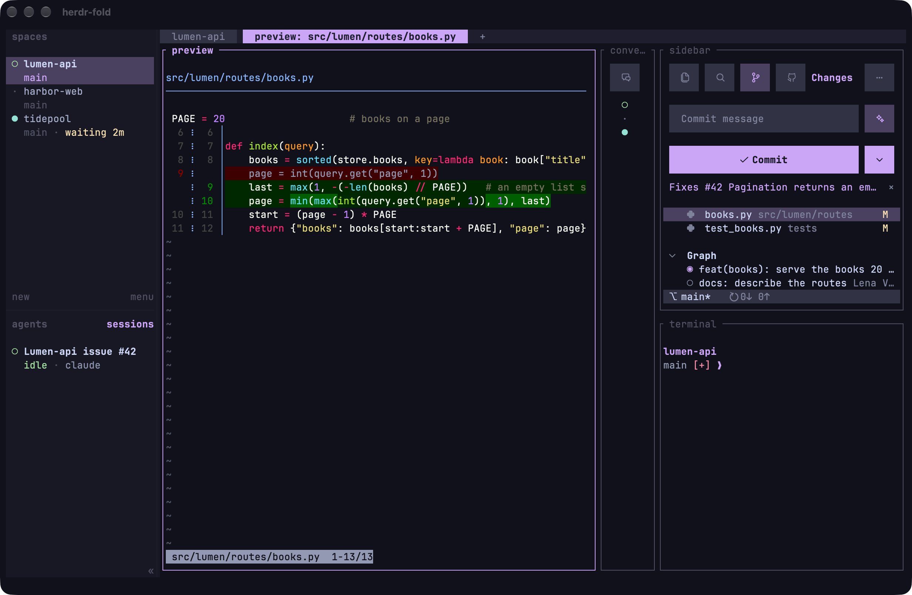

# The sidebar

The sidebar at the top of the right column is herdr-fold's own herdr plugin, `herdr-fold.sidebar`
(`src/plugins/sidebar/`): Files, Search, Changes (git) and, for a repository on GitHub, Issues in one pane, on
macOS, Linux and Windows. Its keys, what it reads and writes on the machine, and how to use it without herdr-fold are in
[its README](../src/plugins/sidebar/README.md). This page is what
herdr-fold does with it.

## How it gets there

- The installer copies it to `~/.config/herdr-fold/plugins/sidebar` and links it (`herdr plugin link`) for its actions
  (the views, the Conversations column) and the one-time tip when a pane is closed by hand, and records the link in
  `~/.local/state/herdr-fold/plugins.txt`.
- `machines.sh` copies it to each remote machine, where the same launcher starts it.
- On its own, without the rest of herdr-fold: `herdr plugin install princesshu/herdr-fold/src/plugins/sidebar`, then
  `herdr plugin action invoke restore-panels --plugin herdr-fold.sidebar` (`restore-panels-windows` on Windows) lays
  out the tab you are in ([its README](../src/plugins/sidebar/README.md#install)).
- A herdr-sidebar you installed yourself stays; the installer names it, since the two do the same.
- The `Brewfile` brings `bat` and `git-delta`, which color the previews; without them a file shows plain and a diff in
  git's colors. It brings `ripgrep` for Search too; without it Search runs git grep, or its own search outside a
  repository.
- The Issues view uses `gh`, which the installer brings and signs in to GitHub. On a remote machine it shows once gh is
  installed and signed in there; the Mac's sign-in never goes to the machine.

## How it starts

It runs in a plain herdr pane named `sidebar`, started by `src/sidebar.sh` (`src/sidebar.ps1` on Windows) with the
system Python: the workspace builder, the tab-layout plugin and `restore_panes.py` run it. In your home folder it opens
`~/Documents` instead. Quitting it (`q`) leaves a shell; `python3 ~/.config/herdr-fold/restore_panes.py` starts it there
again. After an update it starts its new version by itself, where it was, and so it does on its folder's new place
when the folder is renamed or moved.

The column keeps one width everywhere: drag it wider or narrower in one tab, and every other tab's column, in every
workspace, gets that width at once; a new column opens at it too. A tab's column is never narrower than its sidebar's
header: 33 cells with three views, 39 with Issues.

## Keys

Cmd + Shift + G (Changes), Cmd + Shift + I (Issues), Cmd + Shift + E and Cmd + Shift + O reach it from anywhere:
[Keys](keybindings.md#panes-and-tabs).

The ⋯ at the header's right edge (or a right click on them, the header or the status bar) closes or shows back the
tab's other panes, one by one (Close Conversations, Show terminal…), and offers Restore panels while any is closed. The
keys inside the sidebar are in its README.

## Colors and icons

The theme setter (`src/themes/apply.py`) writes the theme's colors to
`~/.local/state/herdr/plugins/herdr-fold.sidebar/colors.json`, and a running sidebar takes them at once. Without that
file it uses the terminal's 16 colors. Its icons are made for the plain `JetBrainsMono Nerd Font`; with the `… Mono`
variant they look small or off-center: set Ghostty's font back, then press Cmd + Shift + ,.
