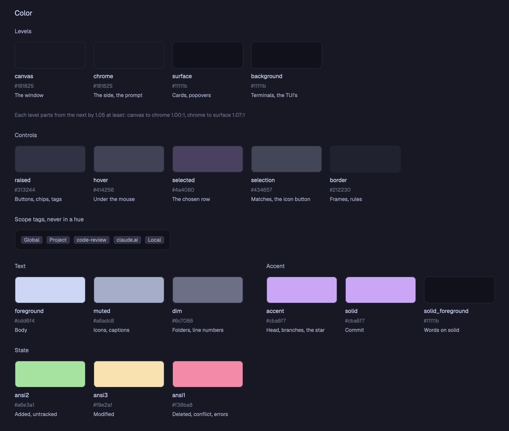
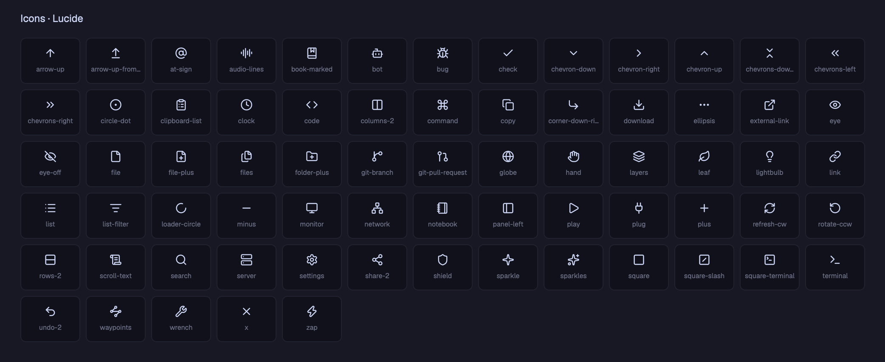
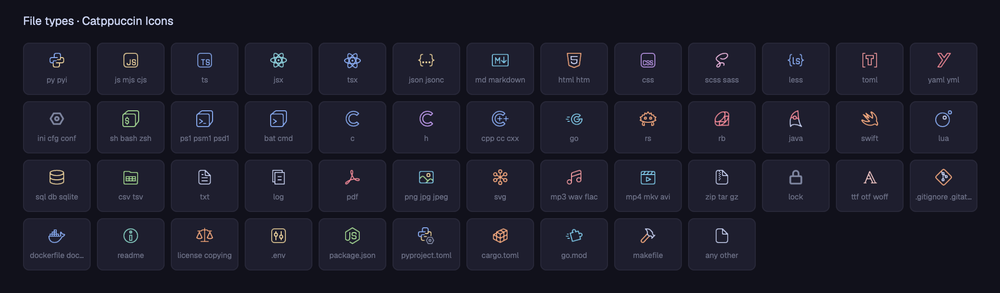
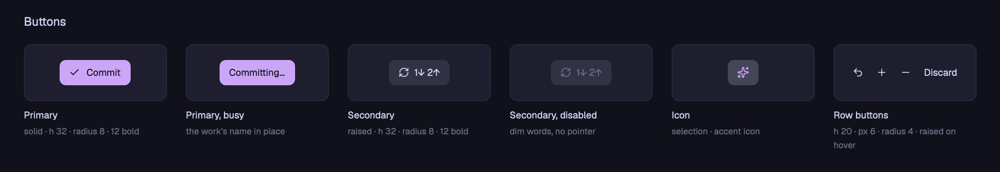
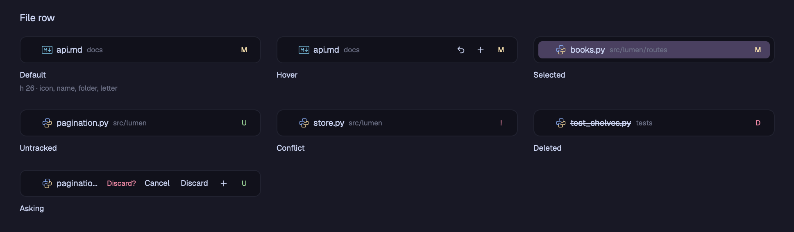
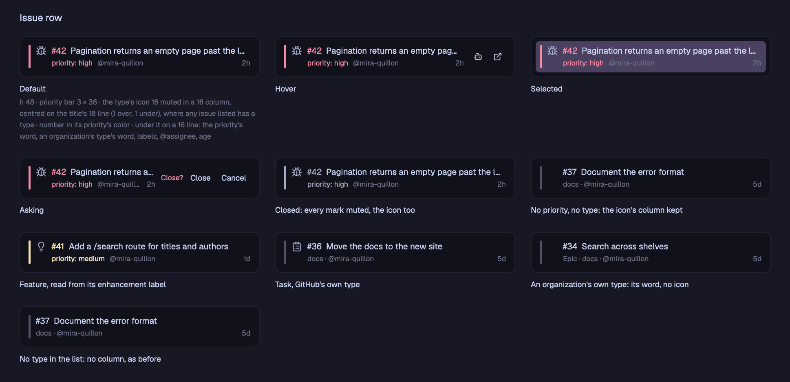
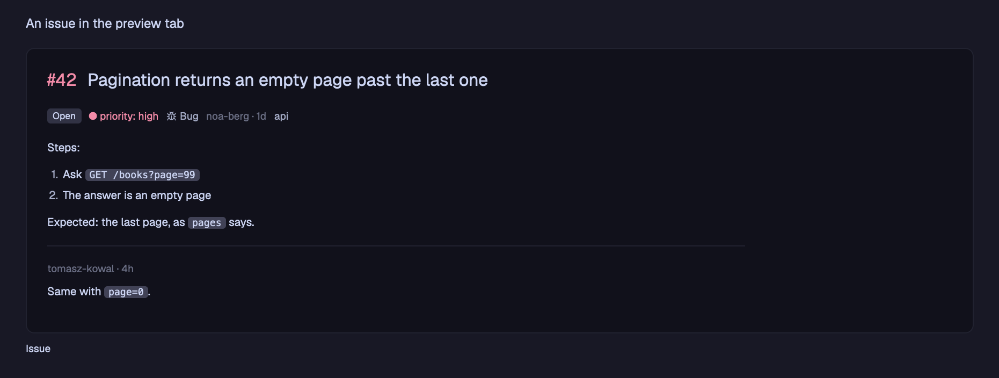
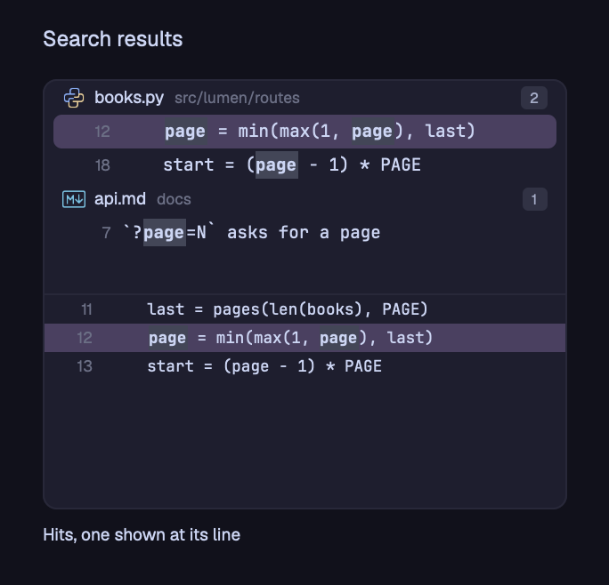
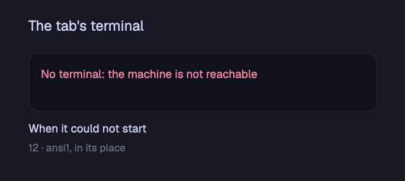

# Styleguide

The Herdr app mod's look, part by part: the foundations it is built on, each component in each of its states, and the
panels they make. The pictures are the styleguide inside the mod itself, drawn by the views' own code from made-up
states, so they show what the mod draws; in the Herdr app, `herdr-app do herdr-fold.styleguide` opens it in a tab: an
index of the parts on the side's level, as Settings lists its sections (180 wide, a row 28, the shown one on the
selection), and the part picked beside it, one part a render (the app stops a render that builds them all). The colors
are the layout's theme, Catppuccin Mocha, as in the TUI.

## Foundations

### Color

| Token | Use |
|---|---|
| `canvas` | the window, behind the cards; a well in a card (a command, a source's tag, the context bar, Effort's slider) |
| `chrome` | the left sidebar, the bars, the prompt, the person's message, a tool's output, what Claude waits on |
| `surface` | the cards (the chat, the dock, a panel floating beside a rail) and the popovers |
| `background` | the terminals and the panes round them: the TUI theme's own |
| `raised` | buttons and chips |
| `hover` | what the mouse is on, a step lighter than `raised` |
| `selected` | the chosen row |
| `selection` | a match in Search, the commit message's ✦ |
| `border` | a control's frame and the rules, between the panel and `raised` |
| `foreground` | body text |
| `muted` | icons and captions |
| `dim` | folders, line numbers, authors, the command field's space name and key |
| `accent` | the checked-out commit, branches and tags, the commit message's ✦, a count's badge |
| `solid`, `solid_foreground` | Commit and its arrow, and their words |
| `ansi2` | an added or untracked file, an added line, an update ready (the status bar's dot) |
| `blocked` | a modified file |
| `ansi1` | a deleted file, a conflict, a removed line, an error |

`canvas`, `chrome` and `surface` are the mockups' three levels, darkest first, each from its theme's own palette and
named in its words (`LEVELS` in `tools/build.py`, with its source); a level a palette lacks is made a step off its
neighbor (halfway between two, else toward black), and each parts from the next by 1.05:1 at least (a test over all 13
themes). Body text, captions (a chip's words on the raised fill too), a count's number on the accent and the words
under the pointer read 4.5:1 at least on what they stand on, in every theme.

| Theme | `canvas` | `chrome` | `surface` | Contrast |
|---|---|---|---|---|
| Catppuccin Mocha | crust #11111b | mantle #181825 | base #1e1e2e | 1.07, 1.07 |
| VS Code (Dark Modern) | a step under sideBar.background #121212 | sideBar.background #181818 | editor.background #1f1f1f | 1.06, 1.08 |
| Vesper | editor.background #101010 | tab.activeBackground #161616 | input.background #1c1c1c | 1.05, 1.06 |
| GitHub Dark | canvas.inset #010409 | canvas.default #0d1117 | canvas.overlay #161b22 | 1.09, 1.09 |
| Tokyo Night | bg_dark1 #0c0e14 | bg_dark #16161e | bg #1a1b26 | 1.07, 1.05 |
| Kanagawa | sumiInk0 #16161d | sumiInk3 #1f1f28 | sumiInk4 #2a2a37 | 1.10, 1.16 |
| Rosé Pine | base #191724 | surface #1f1d2e | overlay #26233a | 1.07, 1.09 |
| One Dark | a step under @level-3-color #1d2126 | @level-3-color #21252b | @syntax-background-color #282c34 | 1.05, 1.10 |
| Dracula | BGDarker #191a21 | BGDark #21222c | BG #282a36 | 1.10, 1.11 |
| Gruvbox | bg0_h #1d2021 | bg0 #282828 | bg0_s #32302f | 1.11, 1.12 |
| Nord | nord0 #2e3440 | halfway #343b49 | nord1 #3b4252 | 1.11, 1.12 |
| Solarized | two steps under base03 #00212a | a step under base03 #002630 | base03 #002b36 | 1.06, 1.06 |

A source's tag (Personal, Project, a plugin's, claude.ai, Local) takes its role's color (`tagColors` in `agents.js`):
Personal the accent; Project, a plugin's and claude.ai the palette's colors nearest the mockups' teal, peach and blue,
each at least 30° of hue from the ones before it (red is the errors'); Local and Managed muted; each moved toward the
text until it reads 4.5:1 on `canvas`, where a tag stands.

### Type

Body text is 13, a button's words 12 bold, a folder or a caption 11, a rail's label 10; code is the TUI's
herdr-fold Mono (`CODE_FONT` in `parts.js`, the layout's), 13 in the preview tab and 11 for a hit's file.

### Spacing, shape and size

Padding and gaps keep to a 4 px grid (`SPACE` in `parts.js`: 2, 4, 6, 8, 12, 16 and up): 4 between two buttons, 6
between an icon and its words, 12 inside a card on every side (`PAD`: a terminal's text, a view's words and fields, its
last row at the bottom; a row's hover pad reaches halfway in: a list 6 in, its row 6 more on each side, a tree's indent
on the left alone), 8 over and under the dock's tabs and 6 at their sides. Panels are rounded 10, controls 8, rows 6 and
chips 4. A test checks every padding, gap, text size and corner against these scales.

### Motion

A section, and the Graph, springs open and shut, its height with no overshoot (`spring`, `SPRING` in `parts.js`), and
its chevron turns with it: GPUI turns nothing once, so `fold()` crosses the two chevrons' opacity on the same spring.
The app animates them itself, never the mod's own timer. The TUI turns a fold's chevron through a frame at 45° (⌟)
between › and ⌄, 80 ms long (`Turns` in its `widgets.py`).

### Iconography

The views' icons are Lucide's, drawn by `icon(name)` in the text's color; a file's is Catppuccin Icons' for its type,
in its own colors (`fileMark`), the types told apart as the TUI sidebar tells them (`core/icons.py`); a connector's is
its service's logo, SVG Logos', in its own colors with no tile under it, a one-color dark mark (Linear, Sentry) in the
text's color (`BRANDS` in `icons.js`, from `core/connectors.py`). `tools/icons.py` fetches the three sets from Iconify
into `app/mods/herdr-fold/icons/`, `icons.js` names each once, and a test fails on an icon no view draws.

## Components

States are named alike throughout: Default, Hover, Selected, Busy, Asking (a second press to confirm) and Error.

### Buttons

Commit is the one solid button; it keeps its color while it cannot commit yet. A secondary button dims its words when
it cannot be pressed. A row's buttons show only with the mouse on the row. Every icon button is `iconButton`: 26
square, radius 6.

### Files

As VS Code's Explorer: a row 26 high, each level 12 further in, a file's Catppuccin Icons' icon and git's color and
letter for its state. A new name is typed in its row; ⏎ makes it, esc drops it.

### Repository

### Commit

### Title row

The window's own row, across its whole width over the sidebar and the tab bar, as commands.html's B draws it: 36 high
with its hairline, on the window's level (`canvas`), a hairline (`border`) under it as the status bar has one over it;
it drags the window, and a double click maximizes it. On macOS the traffic lights sit in it, 18 in, on its middle line
(the layout's `traffic_lights`); elsewhere the window's own buttons stand at its end, 8 in, their tips opening to the
left. At the window's centre the command field: 300 by 25, 5 under the row's top, 8 inside and its parts 6 apart, a
hairline round it, rounded 6; the palette's mark (⌘ on macOS, else its search, 14, muted), the shown space's name faint
in it (`dim`, 12) as a placeholder, and the palette's key at its end as bound (`dim`, 11; `herdr-fold.palette`, the
layout's own binding over the global one). Under the pointer it takes the hover fill and the text's color, its tip
`Commands`; a press opens the command palette onto it. While the palette is open the field hands its place over to the
palette's own and is drawn empty: the app keeps a popup 8 under the window's top, so a lit field would show a sliver
above the palette. Narrower than the window leaves it between the lights' room (or the buttons') at both ends, the field
narrows; under 160, the mark alone, an icon button whose tip says the key.

### Command palette

herdr-fold's own, opened onto the title row's field as commands.html's Nyitva draws it: 600 wide on the window's centre
(the window less 8 at each side when narrower), 8 under its top, the nearest the app lets a popup come (Nyitva draws it
at the top), so its field, 25 high and 5 inside, lies over the title row's 8 lower than drawn, the field becoming it:
the mark where the field's is, `Type a command…` in the space's name's place and Esc in the key's (`dim`, 11), a
hairline round it in the inputs' color (`input`), rounded 6, 4 inside the palette's edge. Under it a hairline across the
palette, then the panels' list form (the chat bar's, `menus.js`: the popover's surface, a hairline round it, rounded 10,
lifted; a part's name 11, medium, dim, 8 over it and 4 under; a row 32, 12 in, rounded 6, 2 apart, the keys' row on the
hover fill, the pointer moving it), 384 high at most and scrolled past it, the keys' row kept in view. The rows are the
app's commands as the app's palette names and groups them (Tab, Pane, Space, Layout, Terminal, Agent, Window, App; the
window's own off macOS, a layout each to switch to, a command it has no name for titled from its own), each with its key
at its end as it works in the layout (the layout's own binding, else a global one the layout leaves, else a terminal's);
after the app's groups herdr-fold's own commands in one more, `herdr-fold` (`PALETTE_OWNED`: Settings…, Files, Search,
Changes, Issues on GitHub only, Agent, Chats, New chat as + names it, Styleguide, Mark agent unread, Commit and push,
Write commit message; not the palette itself, nor Commit, whose message is typed in Changes, nor Sync, Changes' own),
rows as the rest. A key is a cap for each part (`keyCap`, 16 high on the row's line, 4 apart, in the text's color on the
keys' row; ⌘ ⇧ ⌥ ⌃ and ↩ ← on macOS, words elsewhere). The first row is lit. Typed, the rows are found as the / menu
finds its own (`slashRank`: a title or command that starts so, then a word of either, then either holding it, then the
words it is known by besides), in one list with no part's name, the best first and lit, each with its group as a muted
tag at its end; nothing found, `No command matches` in the first row's place. Enter runs the lit row, ↑ ↓ move it, Esc,
a press beside it or the key again closes it; a command that needs a name asks for it, as the app's does. There is one
palette: in the layout the app's palette key opens this one.

### Tab bar

herdr-fold's own, in place of the app's, under the title row: a tab 28 high, its × on the active one and under the
pointer, + after the last tab; at its right end, over the dock, the dock's own actions as center-chat.html draws them:
Chats (✦), More (⋯) and » (« while the dock is a rail), » in the row of the left sidebar's own toggle and never moving.
Each is an icon button, 4 apart, its tip opening to the left. Chats' dot (ansi3) says chats wait on you, their number in
its tip ("Chats · 2 waiting"); Chats is in the accent while its list shows. More has no dot (a newer herdr-fold is the
status bar's to say); its menu opens under it, its tip quiet till the pointer leaves it. A dot is 7, centred on the
icon's top-right corner as a count's badge sits, ringed 2 in the bar's fill. With the dock a rail the three stay where
they are, Chats floating its list beside the rail.

### Status bar

The window's foot, herdr-fold's own in place of the app's, as the mockups' `.status`: 28 high on the side's level
(`chrome`) under a hairline, 16 in and its items 16 apart, 12 in the captions' tone. The machine (This computer), the
branch, then the agents behind a 6 px dot: those waiting on you in ansi3 (`1 of 3 agents waiting for you`), else those
working in the accent (`1 agent working`), else how many (`2 agents`) with a dim dot. At its end, only while Herdr has
one ready, its update: a green dot (`ansi2`) and `Update ready: herdr-core 0.1.21` or `Update ready: Herdr 0.1.16`, 20
high, 6 inside, rounded 4, on the hover fill in the text's color under the pointer, its tip saying what a press does
(herdr-core updated, the terminals running; Herdr restarted into it); while herdr-core updates, a spinner in the dot's
place and no press. With neither ready, a newer herdr-fold is the same item, `herdr-fold 0.4.0 is out`: its words
say what is true (a press updates nothing, it opens Settings at About), so they are not Update ready. One item at a
time: Herdr, herdr-core, herdr-fold. It is the mod's one sign of an update.

### The dock's tabs and the search field

The right panel is a dock as the TUI sidebar: one card, its top level with the tab's, its views' text tabs on top
(center-chat.html's: 8 over and under them and 6 at the sides, then a hairline: 45 high, the views' stack's header) over
one view at a time. A tab is as wide as its words: 28 high, 6 inside each side, so the first tab's name stands 12 in as
the views' words under it, rounded 8 as a control, its name 13 in the muted color; the shown one on `raised` in the
text's color, the one under the pointer on `hover`; the tabs stand 2 apart, one control (two separate hover backgrounds
keep 4, `GAP`). Changes' count follows its name, 6 after it, in the accent badge (`badge`): 18 high and at least as
wide, 4 inside each side, its number 11 semibold; Agent, the fifth, wears its agent's own icon (the app's for the
program, 14, 6 before its name; Lucide's `bot` while none is known) and, while its setup has a problem, a dot 6 after
its name, as a tab's state dot: `ansi1` for a failed server, else `ansi3` for one to sign in, the problems in the tab's
tip; a count is short when large, as the TUI's: as it is
to 999, then 1.2k, 18k, 1.3m, four characters at most (`shortCount`). While the Chats list shows in the view's place no
tab is shown, Chats at the tab bar's end lit instead. Past the card's width the last tabs leave, never the shown one
(`tabFit`, each tab's width as drawn). The tab bar's » folds the dock to its rail, and the dock is open or a rail, never
hidden. On the rail a count sits in a smaller badge on its icon, as VS Code's activity bar has it (`countBadge`): 14
high, its number 10, its centre on the icon's top-right corner, out of the flow, so a count coming, going or growing
moves no icon. More, at the tab bar's end, opens its menu under it: the views with their checks, a rule, Settings….

### The panel folded to its rail

Folded, the dock is a rail of its views' icons (Agent's Lucide's `bot`, a problem of its setup a dot on its corner as
a folded side's state dot: 9, ringed 2 in `chrome`, red over yellow), those hidden in More's menu left out, as the
left sidebar folds (Chats and More stay at the tab bar's end); a press floats a view beside it, as wide as the dock, its
head dragging it, the grip at its foot sizing it (12 high, a 24 × 4 bar in the border's color, muted under the pointer,
the accent while dragged, the resize cursor; its head and three rows at least, the window less 56 at most, a double
click its tallest or back); Chats, from the tab bar's ✦, floats with its filter taking the keys. Terminal shows or hides
the tab's terminal under the tab, a card 8 under the tab's, the centre's width, 240 high at first and as dragged after
(as VS Code's panel); while it shows, Terminal is lit: the selected square, its icon and name in the accent. A tab with
no terminal shows no card there, Terminal unlit with its tip.

### Section header and count chip

### File row

### Graph

### Menus

Every menu is a popup (`Menus` in menus.js), as the app's own: under the button that opened it, its right edge with
the button's, above the button where it does not fit under it (the chat's bar), or at the pointer for a right
click; it lays over what is below it, and a press beside it closes it. The TUI's menus open the same way.
A button that opens a list to choose from (Commit's modes, a new chat's agent) carries ⌄ at its right end;
one that acts at once carries none, nor do the chat's model and mode chips, as center-chat.html draws them. A rule
parts a menu's kinds of line, as the dock's More its views from Settings…. A line that opens a window ends in ….
A line's note stands at its end, 11 in `dim`, or in its tone's color (a new chat's agent to `sign in`: `ansi3`).
A line that cannot be chosen now stays in its place in `dim`, its tip saying why (a running chat's Delete…).

### Problems and empty states

What a list says instead of rows (loading, none, its own failure) stands in its first row's place, and the rows take it;
what was done or went wrong stands under the list, on the card's foot (`footNote`: 12 in, 6 over it, 11, dim, a failure
ansi1, wrapping), as the TUI's last row: a done thing goes after four seconds (`NOTE_MS`), a failure stays until the
next. Neither moves a row. Changes keeps it over the card's last strip instead (opaque, a hairline over it, × to
dismiss), so its Graph never moves; its composer is always two rows: the push offered is said in the empty field, the
issue the next commit fixes is a chip at the field's end, and a commit, a sync, a pull or a push under way turns ↻ into
a spinner whose tip names the step, Commit keeping its words.

### The Agent panel

The dock's fifth view, as center-chat.html's Agent panel: an agent's setup as layers. The words are core's
(`agent_setup.py`'s `layers()`), the TUI's Agent view's too; the view keeps the layout (`agent.js`, its rules in
`layers.js`).

| Part | Measures |
|---|---|
| Head | 12 in and over it, 6 under: the agent's icon 14, its name 13 semibold, `in lumen-api` in `dim`, 6 apart; the filter's icon button at its end, in the accent while its field shows (the fields' form, 8 under it) |
| Health | 12 in, 2 over and 8 under, a hairline under it: the bar 6 high on `canvas`, its parts round-ended and 2 apart, each as long as its share, in the tags' colors (rules Personal's, skills Project's, connectors claude.ai's); 6 under it the words 11 in `dim`, and the problems' chips at the line's end, 6 apart: 16 high, 6 inside, rounded 4, 11 medium, `ansi1` on its 12% tint of the card, `ansi3` on its 10% |
| Section head | 28 high, 6 in, rounded 6, the hover fill under the pointer: the chevron 14 in `dim` (`fold`), its title 12 bold, its count 11 in `dim`, 6 apart; at its end its summary 11 in its tones, 8 apart, and its cost 11 in `dim`, right in the costs' column, 40 wide |
| Row | 26 high, 24 in and 6 from the edge, 12: its icon 14 in `muted` (a failed one's `ansi1`, a conflict's `ansi3`), its name (one that does not run here in `muted`), its note 11 in `dim`, both agents' icons 12, the used dot 6 in `ansi2`, 6 apart; then its state 11 in its tone, its tag (`scopeTag`) right in the section's tags' column, its cost in the costs' |
| Conflict | 40 high: the rule, and its sentence under it, 11 in `ansi3` |
| `11 more` | 24 high, 11 in `dim`, from the names' column; the hover fill, rounded 6 |
| Usage | the first section, its head a section's with no count; folded, its tightest figure before Open Usage, 4 apart: the agent's icon 14, 6, then its words 11 in `muted` and its figure semibold in its level's color (`levelInk` on the card), 4 apart (`5h 72%`, `~$18.40 of $50`). A row an agent, 28 high, 24 in and 6 from the edge, rounded 6, the hover fill under the pointer, the shown agent's on `raised`: its icon 14, its name 12, its plan's word 11 in `dim`, 6 apart; at its end two columns, right-aligned, 52 wide each: `5h` and `wk` in `muted`, each percent 11 semibold in its level's color, 4 apart; a folded row on an API key its month's figure instead, the same form, `of $50` in `muted`; last the chevron 14 in `dim` (`fold`: down open, right folded). A press opens or folds it |
| Cost lines | under an agent's row and its reset's line, from the names' column: a figure's line 20 high, 11, its label in `muted` left, its figure semibold right with its unit in `muted` 6 after it; a budget's bar 3 high in a room of 8, the limits' bar's form, its fill `ansi2`, `ansi3` once over (`levelFill`); the budget's words 10 in `dim`, 16 high; over its budget the figure and the pace in `ansi3` as small words read it (`levelInk`). An agent with costs and no limits has a row of its own: its icon, name and plan's word, no percent |
| Open Usage | at Usage's head's end: 22 square, rounded 6, Lucide's external-link 14 in `muted`, `raised` under the pointer, its tip `Open Usage` |
| Usage bar | on an open row's lower edge, from the names' column to 6 from the row's end: 3 high, round-ended, its track `canvas` (the health bar's), its fill the level's color; under the row a line 16 high, 10 in `dim`: when that window resets, and a reading's age at its end |
| Chosen row | a press chooses a row: the hover fill under the pointer, the chosen one on the accent's 14% of the card (`chosenFill`), its state's word read on that |
| Properties | under the layers, on the side's level (`chrome`) with a hairline over it, 12 in, its parts 6 apart, 12: the title 20 high (the row's icon 14 in its tone, its name bold, its state 11 at the end, 8 apart); a line 20 high: its label in `dim` in a column 44 wide, 8, its value in the code font 11 (a phrase, `Used`, in the text's), a third column in `dim` at the end; the error 8 and 6 in, rounded 6, the code font 11, `ansi1` on its 8% of the level (`errorColors`); a rule's first lines in the code font 11, `muted`, a line 16, each cut; a description 11, `muted`, three lines at most |
| Actions | 8 under the rest, 6 apart, wrapping: 26 high, 12 in, rounded 8, 12; the first on `raised`, the others plain in `muted`, the hover fill under the pointer; while Claude checks a server, `Checking…` in `dim` and the state a spinner 12 in the accent, on its row too |
| Connector | its row's and its properties' mark is 16 square in the icon's place: the service's logo, or for one of no known brand its letter 10 bold in white on a tile rounded 4, in a space's avatar's colors by its name (`tile`) |
| Signing in | the row's state `signing in` in the accent after a spinner 12 (Lucide's loader-circle, a turn in 0.9 s); in the properties a line 20 high, the spinner and `Finish in your browser`, 8 apart, then `Open the page again` raised and `Cancel` plain |
| Buttons | `Connect` is the one solid button (`solid`, 12 bold); else the first is on `raised` and the rest plain in `muted` (`actionLook`); one that cannot be pressed now (Turn off with no Claude in the folder, any while its command runs) is in `dim` with no hover, its tip saying what it waits for |
| Add | Connectors' +: 22 square, rounded 6, Lucide's plus 14 in `muted`, before the costs' column; `raised` with a hairline in the accent while its menu is open. The menu 4 under it, its right edge with the button's, 200 wide, the panels' form (`panelSurface`, `panelRow`: a row 32, its icon 16 in `muted`): `From claude.ai…` under external-link, `By URL…` under link |
| Add form | in the properties' place, their level and padding, 6 apart: the title 20 high (Lucide's link 14 in `muted`, `Add a connector` bold); a field's line 28 high, its label in `dim` in the properties' 44, the field rounded 8 on `canvas` with a hairline, 8 in, the code font 11; the one with the keys edged in the accent, a refused one in `ansi1` with why under the fields, 11; For a two-part switch on `canvas`, 2 in, rounded 6, a part 20 high, 6 in, rounded 4, the chosen one on `raised`, the other in `dim`; `Add and connect` solid (`Adding…` while its command runs), `Cancel` plain |
| Agent chip | the head's: 26 high, 6 in, rounded 6, its parts 6 apart (the icon 14, the name semibold, `in lumen-api` in `dim`, ⌄ 12 in `dim`); the hover fill under the pointer, `raised` with a hairline in the accent while its list is open |
| Agents' list | a popover 4 under the chip, 300 wide, the chat bar's panels' form (`panelSurface`, `panelRow`): its head 12 semibold in `muted` (12 in, 6 over, 4 under), a row 32 (the agent's icon 16, its name 13, its plan's word 12 in `dim`, 8 apart), at its end `sign in` as a problem's chip (`ansi3` on its 10%), else ✓ 14 in the accent on the one shown, whose row stands on the accent's tint; a rule, then `Add an agent…` under Lucide's plus in `muted` |
| No setup to show | in the layers' place, centered, 24 in, 8 apart: the agent's icon 28, the title 13 semibold, the words 12 in `muted`, 272 wide at most, a line 18; an install line in the code font 11 on `canvas`, 28 high, rounded 6, Copy its icon button (a check for 2 s once copied); Sign in 26 high, 12 in, rounded 8, 12 bold on `solid`; `Open its page` 12 in `muted` with Lucide's external-link 12; the last line 11 in `dim` |

A tone is one color everywhere (`toneColor`): failed and deny `ansi1`, sign in and ask `ansi3`, allow `ansi2`,
connecting the accent, off `dim`, any other state `muted`; as small words it is moved toward the text until it reads
4.5:1 on the card, a chip's fill, the chosen row or the properties' level (`toneInk`, `chipColors`; a test over all 13
themes), as a source's tag is. A problem's chip is pressed: 6% more of its tone under the pointer (`CHIP_LIFT`), and it
chooses its row. A row's properties repeat no line their own title says (a sub-agent's model, a rule named after its
file: `propertyLines`), as the TUI's leave out what the row shows; only what this client does has a button, Claude's
own commands on Claude's rows alone (`doable`). A
section's rows spring open under its head (`SPRING`), each view's slides its own. The tags' column is as wide as the
section's widest tag, twelve characters at most (`tagRoom`), so its states stand in one column before it; under 300 wide
the tags leave. What it says instead of rows (loading, the read's failure in `ansi1`) stands 12 in, 12,
in the first row's place; where an agent stands with no setup to show (not signed in, not installed) is
core's words (`standing()`), the TUI's too; one whose setup is not read has its head alone. The agents' list holds
installed agents only and never an e-mail: a plan
shows as its word, or not at all.

Usage is a meter list, its words core's (`usage.py`'s `section()`), the TUI's too. A percent's level is the status
line's: under 50 `ansi2`, from 50 `ansi3`, from 80 `ansi1` (`levelColor`); the level is never the only sign, its number
stands beside it (a folded row's figure is that number in its color, no dot). The agent in use is open, the others
folded to their row; each dollar figure herdr-fold computes wears `~`, a budget none. As small words the color is
moved toward the text until it reads 4.5:1 on the card or the lit row (`levelInk`), as the bar's fill until it is seen
3:1 on its track (`levelFill`; a test over all 13 themes for both).
The track is `canvas`, not `raised`: on `raised` six themes' red or green falls under 3:1. A window past its reset
shows nothing in its column, the other keeps its own; the bar and the reset are then the week's. With no agent's limits
known it says `Not known yet` in the first row's place, 11 in `dim`; a failed read says why there, in `ansi1`.

### The Agents tab

The main area's tab of that name, one a space, under Lucide's share-2 in the tab bar: usage.html's head, its Graph
(agent-graph.html's Wiring and This conversation) and its Usage (usage.html's Riport). The nodes, the edges, the
figures and every word are core's (`graph.py`, `costs.py`, `report.py`); the views keep the layout (`agentstab.js`
and `usageview.js`, their rules in `graph.js` and `report.js`). The styleguide's parts are `agents-graph` and
`agents-usage`.

| Part | Measures |
|---|---|
| Head | on the card, 12 in and over it, 8 under: the scope's chip 26 high, 6 in, rounded 6 (the agent's icon 16, `Claude in lumen-api` 15 semibold, ⌄ 14 in `dim`, 6 apart), the hover fill under the pointer, `raised` with a hairline in the accent while its list is open; the list the Agent panel's agents' list, the agents core reads alone; 12 after it, where a conversation was read, the graph's views as a switch (`segmented`: Wiring, This conversation); at the head's end the tab's two views, Graph and Usage, 16 apart: 13, 26 high, the shown one in the text's color over 2 px of the accent, the other in `dim` |
| Switch | `segmented` in `parts.js` (usage.html's `.seg`): 26 high on `canvas` with a hairline, 2 in, rounded 8; a part 8 in, rounded 6, 12 in `muted`, the chosen one on `raised` in the text's color, the hover fill under the pointer |
| Canvas | 12 from the card's sides and foot: a hairline frame, rounded 10, on `surface`; dots 2 square, 20 apart, in the text's color at 5%; scrolled both ways where the graph needs more room |
| Columns | their names 11 in `dim`, 48 down: In from the left edge, Agents over the agent, Uses to the right edge; the first node 80 down, 24 from the sides; two nodes 12 apart, two groups (rules and skills, tools and connectors) 32; the agent on the middle, its sub-agents 48 under it, 16 in, 12 apart; In and the agents 96 apart at least, the agents and Uses as far as the widest edge's gates need (`gatesRoom`: 96 to 264); with nothing going in, the agent from the left edge |
| Node | on `chrome`, a 1 px line in the edges' color, rounded 10, lifted (`shadow_md`), 8 over and under and 12 in, 190 wide at least (the agent 250, a sub-agent 230), 300 at most: its icon 14 in `muted` (a connector's logo or letter tile 16, the agent's own icon), its title 12 semibold, its source's tag 11 at its top right in the tag's color read 4.5:1 on the node (`tagInk`), cut at twelve characters; 2 under it its line 11 in `dim`, 16 high |
| Agent's node | its fill the accent's 6% of `chrome`, its edge the accent at 60%, its line in `muted`; its chips 6 under: 18 high, 6 in, rounded 4, the code font 11 in `muted` on `canvas`, 4 apart |
| A node's state | failed: its edge `ansi1` at 60%, its line in red; to sign in: its edge `ansi3` at 50%, its line in yellow (`toneInk` on the node); one that does not run here at half strength, with no edge |
| Chosen node | ringed 2 in the accent, drawn over the others; under the pointer the grab hand, the closed one while it drags |
| Edge | 1.5 wide, from a node's right to the next one's left as a cubic with handles 120 long (half the way where closer), a node's edges leaving it 4 apart in their targets' order; a sub-agent's straight down from its agent's foot, 24 in from its own left; always solid in `dim`; on demand dashed 5 and 5; waiting dashed in `ansi3`, failed dashed in `ansi1`; each color moved toward the text until it is seen 3:1 on `surface` (`wireColor`) |
| Gate | pills centred 55% along their edge, over the nodes: 18 high, 6 in, rounded 4, a hairline, on `canvas`, 11, 4 apart; ask in `ansi3`, allow in `ansi2`, deny in `ansi1`, a hook in the accent, each read 4.5:1 there (`toneInk`) |
| Legend | at the canvas's top right, 12 in: 26 high, 12 inside, rounded 8, a hairline, `chrome` at 90%; a sample 22 wide and 2 high (dashed: three 5 px pieces), its word 11 in `dim`, 6 apart, the kinds 12 apart |
| This conversation | what ran at full strength, the rest at half (`faded`), its edges in their colors at 35%; an edge that ran 2 wide in the accent, the one a call waits on 3; gates on the edges that ran alone; a first use's number a disc 18 across in the accent, 11 bold in the accent's own text color, its centre on its node's top right corner (`badgeAt`); at a node's top right its cost 12 in the text's color, or its calls 11 in `muted`, in the tag's place; a model's square 8 with corners 2 before the line, 6 apart; the share a bar 4 high, 6 under the line, round-ended, its track `raised`, its fill the model's color; the legend gains `ran here`, its sample in the accent |
| What a node ran | the properties 340 wide, the cost with its word 12 at the title's end; a line 20 high, its label in `dim` in a column 82 wide, its value in the text's font, the value's note in `dim` after it, 8 apart; `Open in Usage` a plain button, `Show in Agent` after it |
| Properties | at the canvas's lower left, 12 in: a popover 300 wide (`popover`, a hairline, rounded 10, `shadow_lg`), 12 inside, its parts 6 apart, 12: the title 20 high (the node's mark, its name semibold, its state 11 in its tone, × 16 square with Lucide's x 12 in `dim`, 8 apart); a line as the Agent panel's (`propertyLine`), its label in a column 70 wide; a folded node's names as a list, a line 20, the name left and its source or gates right in `dim`, 240 high at most, scrolled past it; the error as the Agent panel's; Open as its buttons (`actButton`), and last `Show in Agent`, plain (raised where it is the only one), on a node the Agent panel has a row of and on the agent's own |

Usage is one column, 1000 wide at most and centred, the head scrolling with it, its blocks 20 apart.

| Part | Measures |
|---|---|
| Filters | one row, 12 apart, wrapping: the periods and the agents each a switch (`segmented`); at the right `Reading the conversations…` 11 in `dim` after a spinner 12, `Budget…` and `Export CSV` as plain buttons (`actButton`), `Budget…` raised while its popover is open |
| Summary | one frame on `chrome`, a hairline, rounded 10; a cell 16 and 12 in, a hairline at its left, the first 1.4 times as wide as the others: its key 12 in `dim`, its value 20 semibold on a 28 line with its unit 12 in `muted` 6 after it on its baseline, its line 12 in `muted`, wrapping, a pace over its budget medium in `ansi3` as words read it there (`toneInk`) |
| Chart card | a hairline frame on `surface`, rounded 10, 16 and 12 in, its parts 12 apart: the title 13 semibold, 16 after it its note or its legend 12 in `muted` (a swatch 8 with corners 2, 6 before its name) |
| Per day | the plot 180 high, a hairline under it; ticks 11 in `dim` right in a column 40 wide, a clean step, four at most (`ticks`), a hairline across at each at half strength; a column 70% of its day's room, 24 at most, its models from the baseline up, the costliest first, 2 px of the card between two segments, the top one's upper corners 4; the days' names 11 in `dim` under their columns, every few past ten, today's always |
| A day's tip | beside its column, 20 from its middle, 8 down: `popover` with a hairline, rounded 8, 12 and 8 in, 168 wide at least, lifted; its date and sum 12 semibold, a row a model (swatch, its name in `muted`, its cost medium at the end), 2 apart |
| Month | 170 high: ticks as Per day's; the budget a 1 px line in `muted` with `Budget $50` 11 over its left end; what was spent a 2 px line in the agent's model's color, the pace on to the month's end the same at 40%, its words 11 in `muted` 20 from its end; today's point 8 across in that color, ringed 2 in `surface`, `$18.40 today` 12 beside it; the month's first and last day 11 in `dim` under the plot |
| By project | a row 32 high: the name in a column 90 wide, 12, the bar 16 high in `muted`, its right corners 4, as long as its share of the largest in 70% of the room, its value 8 after it; core's note 12 in `dim` under the rows |
| Table | a hairline frame, rounded 10: its head 36 high, 12 in, the title semibold and core's note 12 in `dim` at its end, a hairline under it; the columns' names 11 in `dim` on a line 28 high with a hairline under it; a row 32 high, 12, its columns 8 apart, the first taking the rest (160 at least), the numbers' right-aligned, a faint line between two rows; a figure's short word (`value`, `spent`, a commit's lines) in `dim` 6 after it; a conversation's models as marks 6 by 12 with corners 2, 2 apart; the hover fill under the pointer, the row asked for on the chosen fill (`chosenFill`); narrower than its columns, scrolled sideways |
| Budget | a popover 300 wide under `Budget…`, its right edge with the button's (`popover`, a hairline, rounded 10, 12 in, 8 apart): `Monthly budget` semibold; a field's line 28 high, the agent's name in `muted` in 72, the field on `canvas` with a hairline, rounded 8, `$` in `dim` before what is typed, `a month` in `dim` after it; why a field was refused 11 in `ansi1`; Save raised, Cancel plain |

Charts follow the dataviz rules the mockups were drawn to: thin marks, a hairline grid, a legend for two or more
series, text in the text's tokens (never a model's color), a model's color following the model wherever it shows, no
second axis. A report of 200 conversations and 30 days draws in 10 ms of script, a week's in under 1 ms (measured in
the demo app with a timer round its draw). Nothing in Usage is measured: a place across is a share of its plot.

What it says instead of a graph (loading, an agent not installed, the read's failure in red) stands 12 in, 12, under
the head; Usage the same (`Loading usage…`, the read's failure, `Reading the conversations…` while nothing is read
yet, core's `Nothing used in this period`), and with no model that has a price it shows no chart, the tables alone.
A graph of 48 nodes and 72 edges draws in 9 ms of script (measured in the demo app with a timer round its
draw): the dots are one dashed path, each kind of edge one path, a node six elements. Nothing moves by itself: a
node follows the pointer while it drags.

### Issues

An issue's number takes its priority's color, as the TUI's traffic light: urgent and high red, medium yellow, low
green; without one, the accent. Closing or reopening asks on the row first. Loading moves nothing and says so once:
the head stays as it is, a refresh of a list shown turns Refresh into a spinner of its size, and the first load, a
failure or none found is said in the first row's place (48 high, the words 12 in, dim, a failure ansi1), which the
rows then take.

### The preview tab

Code, Split and Picture are a choice of a few, as Issues' Open and Closed: side by side, the chosen one filled.
With Split chosen, an icon button after them turns the two the other way, its icon the way they turn to.

### Spaces

Drawn as the app's own list, on the 4 px grid (a row 32 high, a worktree's and a machine's head 28; avatars in the
colors every app mod gives a space), with the TUI's waits: `waiting 12m` in ansi3, last in the row. Over it the
sidebar's head, on the tab row's line (as high as the tab bar, under the title row): Herdr's mark and name at its start,
as the app's own head has them, in the Spaces rows' columns (the mark 18, rounded 4, 16 in over their avatars; the name
13, semibold, in the text's color, 8 after it); Go to space or tab (the app's picker) and the sidebar's toggle at its
end, as the mockups draw it, 8 in, the toggle over Spaces' +.

Each machine's home is its first row, always. With no space there it is a space's row all the same, in its place and at
its height, saying nothing is open by being dim: the avatar a 1 px outline in `border` with `~` in `dim` where the
fill and the white letter were, the name in `dim`, nothing after it (no branch, no count). A hover lights it as any
row, a click opens a terminal there; in the floating list, the same row at that list's height.

### Chats

Chats shows in the dock in the view's place, on its card, as a view does: its filter on top takes the keys, 12 from the
card's edges as every view's field, then the spaces with their chats (a space's row 26 high, a chat's 24, its mark under
its space's name), their highlight 6 in and their first mark 12, as every list's. Its lit button again, esc in the list
or its filter, or another button brings the view back, and so does a chat opened from it; esc while a chat is renamed
drops the name only. Delete… is asked in the chat's own row, as Files asks Move to Trash: `Move to Trash?` (11,
`ansi1`) and two row buttons, Cancel then Move, in the time's place, the name staying and Move's tip saying it whole;
esc drops the question. On Move the row leaves at once, the rows under it sliding up as a fold's do; a Trash that did
not take it brings the row back, why on the card's foot ([Problems and empty states](#problems-and-empty-states)).

### The sidebar folded

Folded, the sidebar is a dock, as Adobe's panels collapse to icons: Spaces on a square (`iconTab`: 30 square, radius
6), its name under it, its most urgent state's dot at the corner; a press floats it beside the dock, a window its head
drags and its × closes (`floatPanel`). The app's footer buttons sit centered at its foot, its toggle left of
the tabs; its head stays empty.

### Search results

### herdr-fold Settings

More's Settings… opens a dialog 600 × 316, framed as the app frames its dialogs, the same size in every section and
state: nothing grows when the section changes or About's how line comes. Its head is 44 high over a hairline: its name
(13, semibold) 16 in, × at its end. Under it the sections' list, 160 wide on the side's level (`chrome`) with a hairline
at its right, 24 over its first row and 8 at its sides: a row 28 high, 8 inside, rounded 6, muted; the shown one on the
selection in the text's color, as Spaces' row. The section beside it is 24 inside. ↑ ↓ change the section; Tab rings
the section's controls in the accent, one at a time.

General: a setting is a row 28 high, its name at the start and its control at the end (Open agents in: the choice of a
few, `choices`, Chat or Terminal), what it steers under it, 8 down, 12 on a 16 line in the dim color, 360 wide at
most.

About: the name (20, bold) and the version line (muted); the state's row, 36 high whatever it says (a mark, ✓ in the
done color or ↑ in the accent, else none; its words, when it looked under them, 12 and dim; its buttons, the app's
own), so a look's spinner turning into its answer moves nothing; how to update on a code line, only while a newer one
is out (About's tallest state, which fills the section's room exactly); the box; Third-party notices. Couldn't check
is in the error's color, with no mark.

### The tab's terminal

### The chat

The prompt sits at the timeline's foot, as wide as its column. A notice stands over it, 8 apart (a usage limit near
its end, then a budget near or past its own, each closed by its ×): 12 and 8 in, rounded 8, 12 in `ansi3` on its 12%
with a hairline of its 25%. Empty, its words name the agent; while the agent works,
they say a message is queued and esc stops it. Its bar holds the + (its menu), the commands (the / menu), Claude's own
terminal (shown under the chat or put away, the button in the accent while it shows), the context meter
(center-chat.html's `.ctxm`: the ring, `context` dim and the share semibold in the ring's color, green, yellow from 50
%, red from 80 %; 28 high, flat), the clock (Lucide's clock: this folder's conversations), then at the right the model
chip, the mode chip, and send or stop. The model chip is center-chat.html's `.chip`: the model and its effort in the
muted tone (Opus 5.5 High), 28 high on the raised fill; the mode chip is flat, its icon and its name; neither carries a
chevron. A chip or a tool whose panel is open is raised and ringed in the accent, as the mockup's. Where the bar has no
room the meter's words are left out first, then the model chip's level, each tip saying what went, each back only with
room to spare (so none flickers); narrower still the bar's tools leave whole from their end (the clock first, then the
meter) and the model's name is cut short; the mode and send are never cut. Files attached stand as chips over what is
typed, 12 in and 4 apart, wrapping: a chip 24 high on the raised fill, rounded 6, the type's icon 16, the name 12 (200
wide at most, its path its tip), its × in a 20 px square.

Both panels open upward, right-aligned on their chip as a menu on its button, on the popover's surface with a menu's
frame, 4 inside, rounded 10. Every panel of the bar has one row: as high as what it holds, 8 over and under it (a
choice's two lines 52, a list's one line 32, the slider's row 40, the switch's 36), 12 in, rounded 6; a choice's name
13 medium over its line 12 and dim, the one in use ✓ at the row's end on the accent's tint (14 %), the keys' row on the
hover fill, the pointer moving it. The model chip's panel is 320 wide: the agent's models. The Modes panel is
center-chat.html's, 372 wide: its head (Modes in the muted tone, `⇧ + tab to switch` at its end, 11 and dim, the keys
as caps), the agent's modes, each its 18 px icon in the muted tone in a 24 px column, a rule, then Effort and
Ultracode with their icons: Effort's slider is a pill 24 high on the window's level, a stop 16 wide for each
of the agent's levels (a 4 px dot, the 14 px knob in the text's color on the one in effect, so nothing moves), the
level's name in a room 76 wide at the row's end; Ultracode's switch is 34 × 20 at the row's end, faint with Claude's
reason as its tip when Claude refuses it. ↑ ↓ step the rows, ← → the level, Enter or Space picks or turns, Esc or a
press beside closes a panel, as does picking a model or a mode. The rows are the agent's: one without switches
(Codex's) has no Ultracode row, and no room is kept.

The / menu and the Context panel are one list form, center-chat.html's (the command palette's too), on the Modes panel's
surface with its rows: a part's name as the app's lists name theirs (11, medium, dim, 8 over it and 4 under), each row
on a 16 line (a 16 px icon in the muted tone, the name, its line 12 and dim after it, cut where long, a source's tag at
the row's end: 11, 16 high on the window's level, rounded 4, in its role's color, as Color has them); a list longer than
384 scrolls, the keys' row kept in view. The / menu is 520 wide, over the prompt (its left edge with the prompt's, 8
over it), so what is typed stays in view: This conversation, Skills, the agent's commands, the first 5 of each and `N
more · type to search` (12, dim, 6 over it, under the names); typed after the "/", what it finds in one list with no
part's name, the best first, lit. The Context panel is 430 wide, left-aligned over the meter: the Modes panel's head
(Context muted, the use in numbers 12 at its end in the text's color), the bar 8 high on the window's level (the rules
in the accent, the skills in ansi6, the rest muted, 2 apart), its legend (12, muted, an 8 px swatch each), Rules and
Skills (a note in a part's place, 12 and dim, under the rows' names: None, `14 more available`; the setup being read, or
why it could not be, in ansi1), then under a hairline what the conversation cost (usage.html's `.ctxcost`: a line 20
high, 12 in, 12 in `muted`: `This conversation` in `dim` on a line 24 high, its figure 15 semibold and core's word
for it in `dim` in a column 64 wide; a row a model, its swatch 8 before its name, its figure medium; then the
tokens' line in `dim` and `Usage ›` at its end, as `Show all in Agent ›`), and under a hairline Compact, 26 high on
the raised fill, its edge with the rows' and
its word over their icons, and at the line's end `Show all in Agent ›`, 12 in the accent as words read it on the
hover's fill (the keys' row), its end with the tags'.

The + menu is connectors.html's, 380 wide, upward and left-aligned on the +, in the panels' one row: Upload from
computer… and Add context… under Lucide's arrow-up-from-line and at-sign, their keys as caps at the row's end (16 high
on a list's line), the first row lit as it opens; a rule; then the head, 32 high: Connectors 12 semibold in `muted`, the
problems' pills as the Agent panel's chips (16 high, rounded 4, the tone's tint and its words 4.5:1 on it), and at its
end `Manage ›`, 12 in the accent as words read it on the hover's fill, its end with the switches'. A connector's row is
its logo 16 (`brandMark` in `parts.js`: the Agent panel's), its name (in `muted` while off) and its switch, 28 × 16 with
a 12 px knob 2 in, the size of a list's 16 line (`toggle`'s line form; Ultracode's stays 34 × 20 on its row). In the
rows' place it says `Reading the connectors…`, why they could not be read (`ansi1`), or `None on in this folder`, 12 and
dim. Add context's list is the / menu's form and width over the prompt: a file's type's icon, its name and its folder 12
and dim after it, under Changed and Files; `Listing the files…`, `No file matches`, `No files here` or why it could not
be listed in the rows' place.

A card takes the prompt's place while Claude waits; its answers are numbered, a digit or ⏎ picks one, esc says no.
When Claude asks in its own terminal instead (a new folder's trust question), a card's head says so in the prompt's
place, 48 high as a card's head, and the terminal shows under the chat, answered there; Hide terminal puts it away
(Show terminal brings it back) and it goes by itself once answered.

Each step's dot says how it went: done, failed (ansi1), running (accent), waiting on the person (ansi3, fading).
One scale spaces the chat (`RHYTHM` in timeline.js), the timeline's from center-chat.html: a call's first line is 24
high and Claude's words' lines 20, the 8 px dot on that line's middle, 8 over and under each step, so steps stand 16
apart and a one-line step has as much line above its dot as below; a heading in Claude's words is bold on its line,
their time at its first line's end. The person's message stands 24 under the last step, the next step 16 under it; a
card Claude waits on 16 under the last step (its head 44 high), the line running on to its edge; the prompt 24 under it,
20 over the window's foot.

A connector's call starts with its service's logo, 16, then its name bold, the tool in the code font 12 in `muted` and
the call's first words in `dim`, cut where long. A sign-in's step is the logo, the name and `needs you to sign in` in
`muted`, its dot `ansi3` and fading as a call's that waits on you, Connect at its end as the way out's button (24 high
on the raised fill, 8 in, rounded 6, 12); while it signs in the dot is the accent and a 12 px spinner stands in
Connect's place; signed in, the dot is done's; why it could not start is said in `ansi1` as words read it, Connect still
there; a server neither to sign in nor on since says `needed a sign-in`, its dot dim, no button.

## Patterns

## A new part

A new component, or a new state of one, goes into the styleguide in the same change: into
`app/mods/herdr-fold/styleguide.js`, drawn by the view's own method from a made-up state, and its picture here is made
again. See [The Herdr app](app.md) for the mod itself.
