# Styleguide

The Herdr app mod's look, part by part: the foundations it is built on, each component in each of its states, and the
panels they make. The pictures are the styleguide inside the mod itself, drawn by the views' own code from made-up
states, so they show what the mod draws; in the Herdr app, `herdr-app do herdr-fold.styleguide` opens it in a tab. The
colors are the layout's theme, Catppuccin Mocha, as in the TUI.

## Foundations

### Color

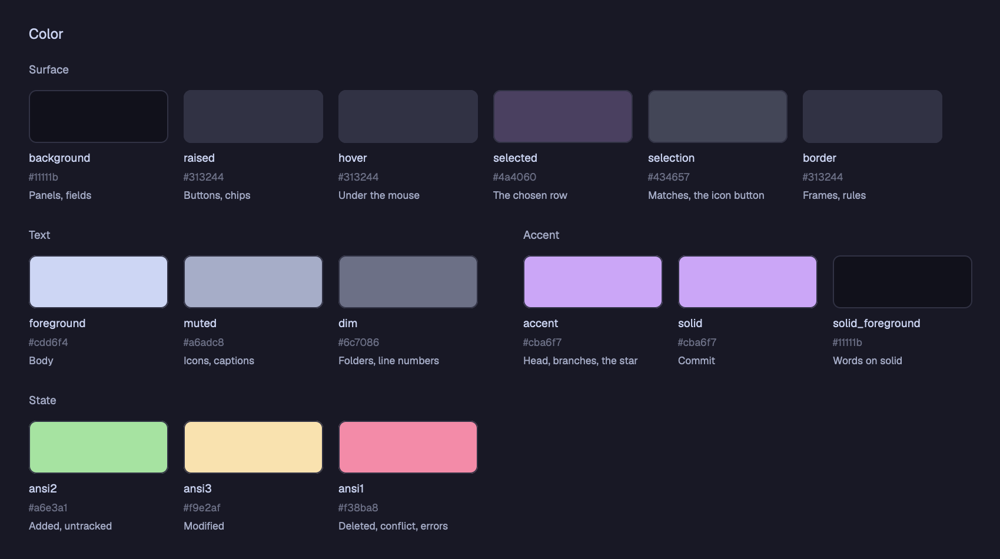

| Token | Use |
|---|---|
| `background` | panels and fields |
| `raised` | buttons and chips |
| `hover` | what the mouse is on |
| `selected` | the chosen row |
| `selection` | a match in Search, the ✦ button |
| `border` | frames and rules |
| `foreground` | body text |
| `muted` | icons and captions |
| `dim` | folders, line numbers, authors |
| `accent` | the checked-out commit, branches and tags, the ✦ |
| `solid`, `solid_foreground` | Commit and its arrow, and their words |
| `ansi2` | an added or untracked file, an added line |
| `blocked` | a modified file |
| `ansi1` | a deleted file, a conflict, a removed line, an error |

### Type

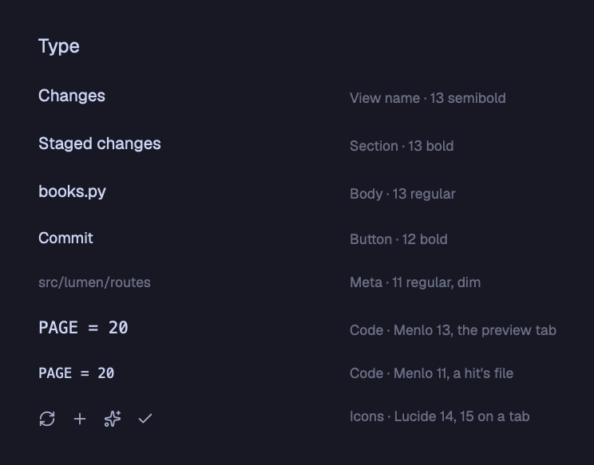

Body text is 13, a button's words 12 bold, a folder or a caption 11, a rail's label 10; code is Menlo, 13 in the
preview tab and 11 for a hit's file.

### Spacing, shape and size

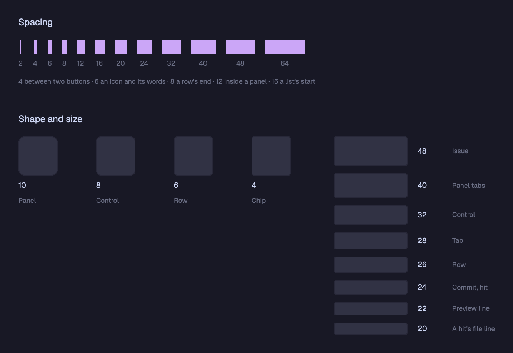

Padding and gaps keep to a 4 px grid (`SPACE` in `parts.js`: 2, 4, 6, 8, 12, 16
and up): 4 between two buttons, 6 between an icon and its words, 12 inside a panel. Panels are rounded 10, controls 8,
rows 6 and chips 4. A test checks every padding, gap, text size and corner against these scales.

### Motion

A section, and the Graph, slides open and shut: its height in 180 ms, easing out, animated by the app itself
(`transition`), never by the mod's own timer.

### Iconography

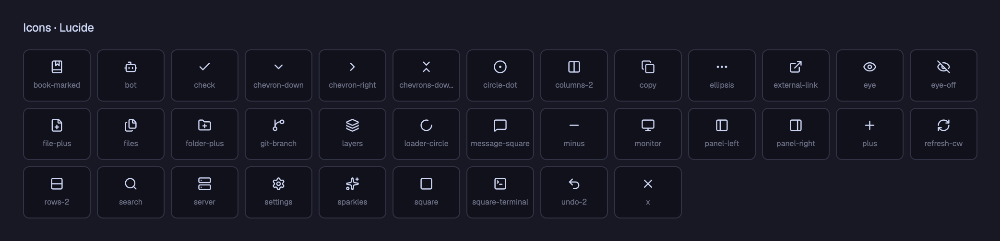

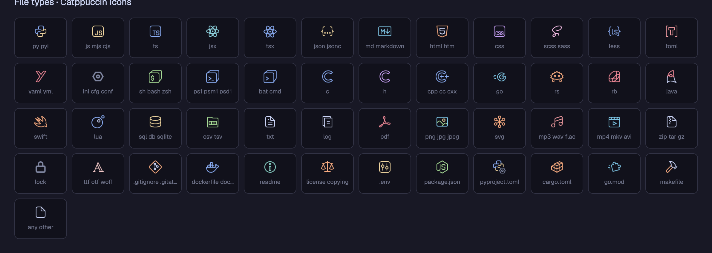

The views' icons are Lucide's, drawn by `icon(name)` in the text's color; a file's is Catppuccin Icons' for its type,
in its own colors (`fileMark`), the types told apart as the TUI sidebar tells them (`core/icons.py`). `tools/icons.py`
fetches both from Iconify into `app/mods/herdr-fold/icons/`, `icons.js` names each once, and a test fails on an icon
no view draws.

## Components

States are named alike throughout: Default, Hover, Selected, Busy, Asking (a second press to confirm) and Error.

### Buttons

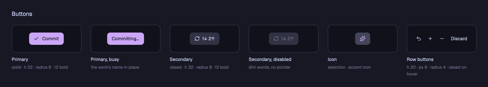

Commit is the one solid button; it keeps its color while it cannot commit yet. A secondary button dims its words when
it cannot be pressed. A row's buttons show only with the mouse on the row.

### Files

As VS Code's Explorer: a row 26 high, each level 12 further in, a file's Catppuccin Icons' icon and git's color and
letter for its state. A new name is typed in its row; ⏎ makes it, esc drops it.

### Repository

### Commit

### Tab bar

herdr-fold's own, in place of the app's: a tab 28 high, its × on the active one and under the pointer, + after the
last tab; at its right end the panel's toggle and, off macOS, the window's buttons, their tips opening to the left.

### Panel tabs and the search field

The right panel is one of Adobe's panel groups: herdr-fold's views, Files among them, as its tabs, on the header of
the stack that holds them. Two hover backgrounds side by side keep 4 apart (`GAP`), tabs and icon buttons alike.

### The panel folded to its rail

Folded, the panel is a rail of its views' icons, as the left sidebar folds; a press floats a view beside it, as wide
as the panel, its head dragging it.

### Section header and count chip

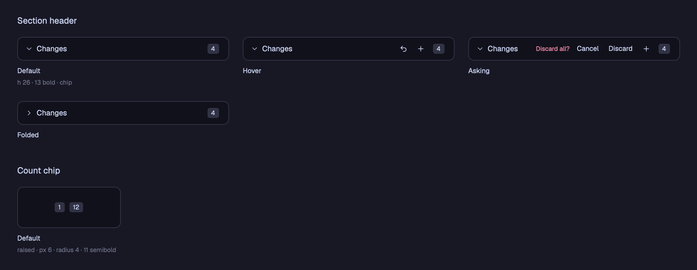

### File row

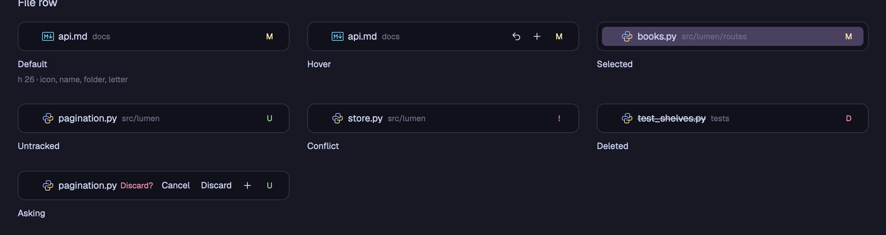

### Graph

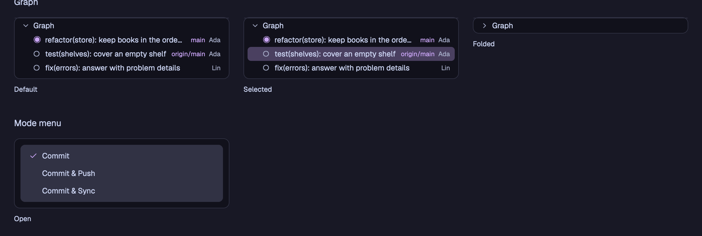

### Menus

Every menu is a popup (`Menus` in menus.js), as the app's own: under the button that opened it, its right edge with
the button's, or at the pointer for a right click; it lays over what is below it, and a press beside it closes it.

### Problems and empty states

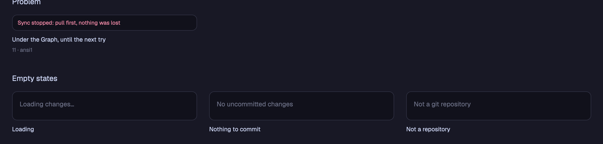

### Issues

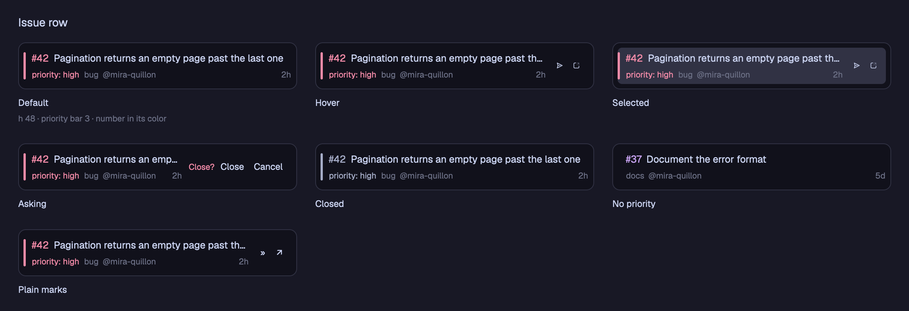

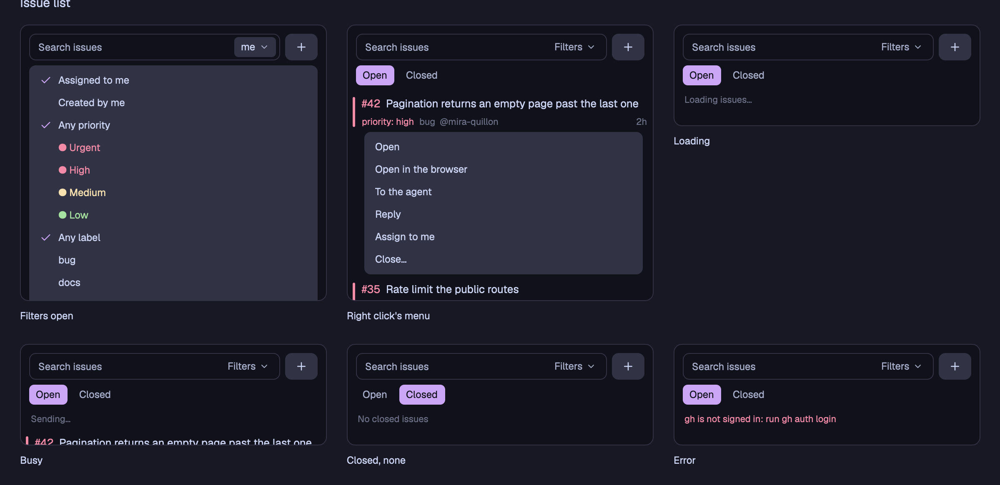

An issue's number takes its priority's color, as the TUI's traffic light: urgent and high red, medium yellow, low
green; without one, the accent. Closing or reopening asks on the row first.

### The preview tab

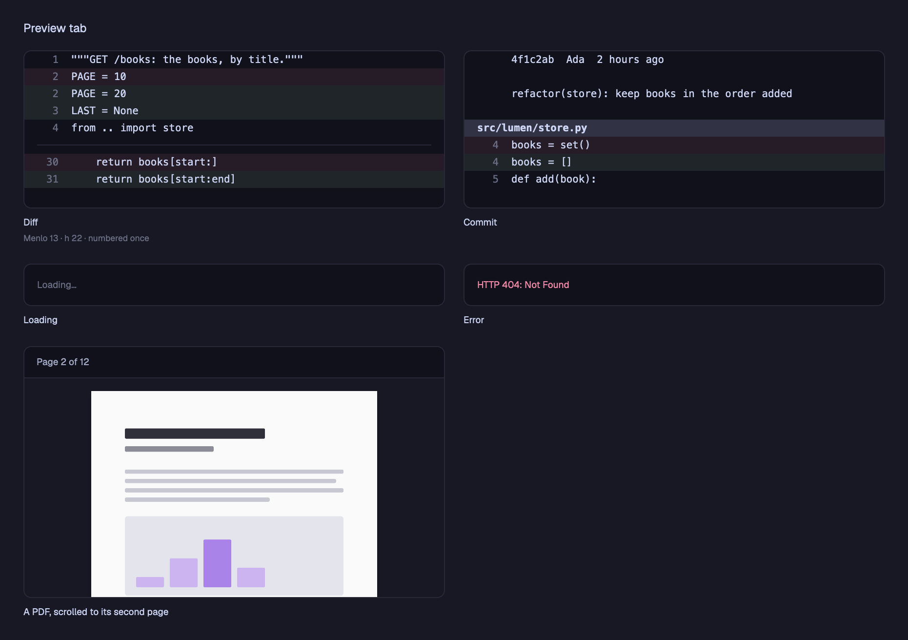

Code, Split and Picture are a choice of a few, as Issues' Open and Closed: side by side, the chosen one filled.
With Split chosen, an icon button after them turns the two the other way, its icon the way they turn to.

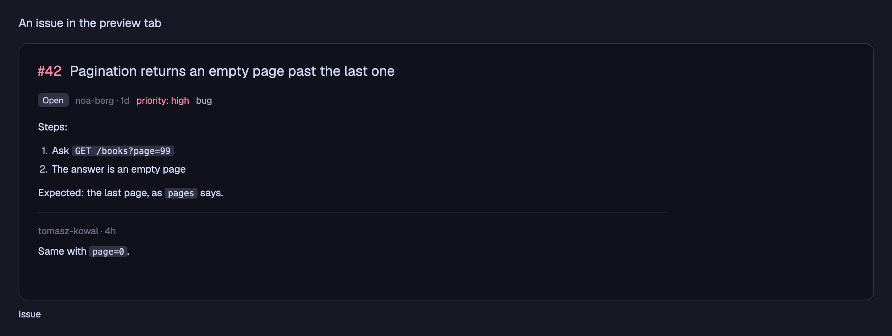

### Spaces

Drawn as the app's own list, on the 4 px grid (a row 32 high, a worktree's and a machine's head 28; avatars in the
colors every app mod gives a space), with the TUI's waits: `waiting 12m` in ansi3, last in the row.

### Conversations

### The sidebar folded

Folded, the sidebar is a dock, as Adobe's panels collapse to icons: each panel on a square (`iconTab`: 30 square,
radius 6), its name under it, its most urgent state's dot at the corner; a press floats it beside the dock, a window
its head drags and its × closes (`floatPanel`). The app's footer buttons sit centered at its foot, its toggle left of
the tabs, where the window's buttons leave it room. Every icon button is `iconButton`: 26 square, radius 6.

### Search results

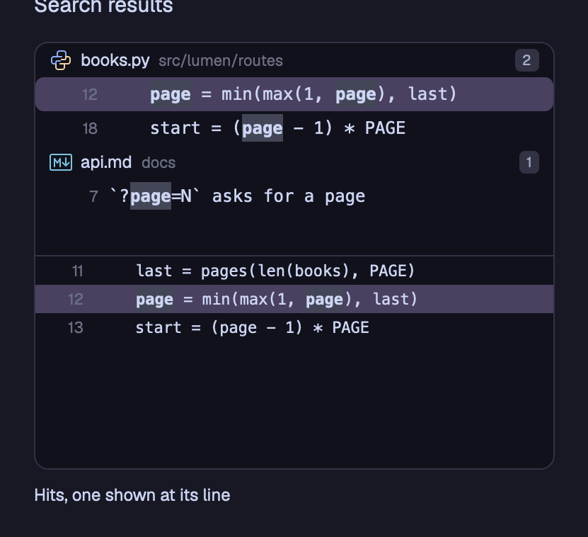

### The tab's terminal

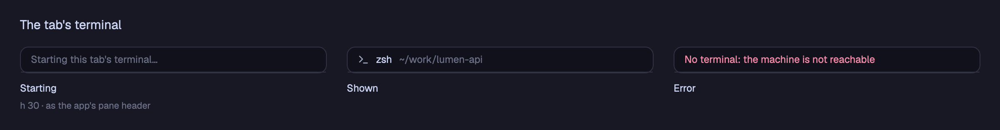

## Patterns

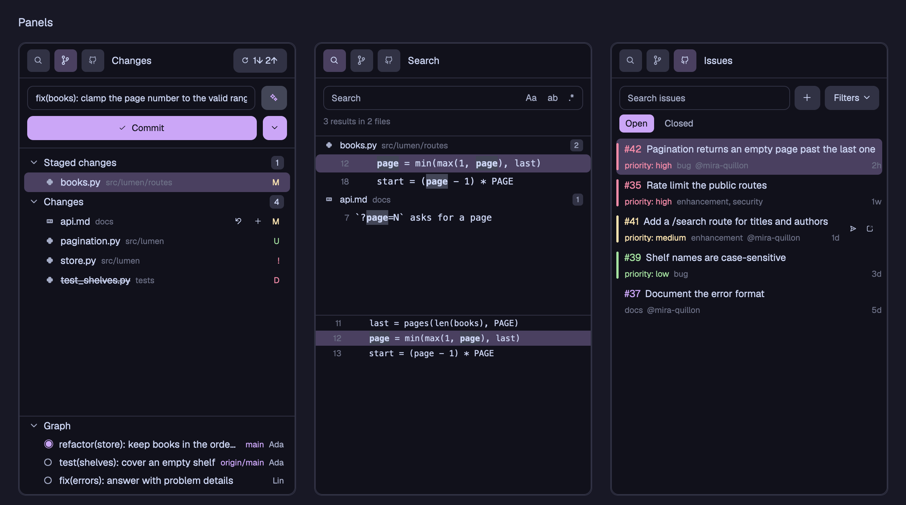

## A new part

A new component, or a new state of one, goes into the styleguide in the same change: into
`app/mods/herdr-fold/styleguide.js`, drawn by the view's own method from a made-up state, and its picture here is made
again. See [The Herdr app](app.md) for the mod itself.
