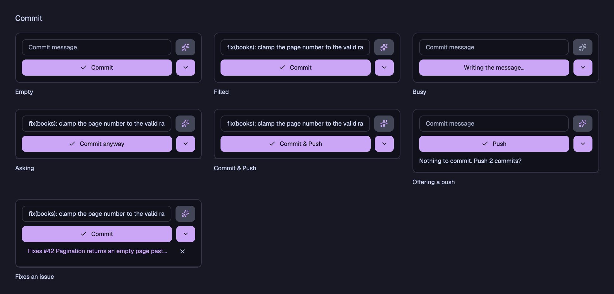
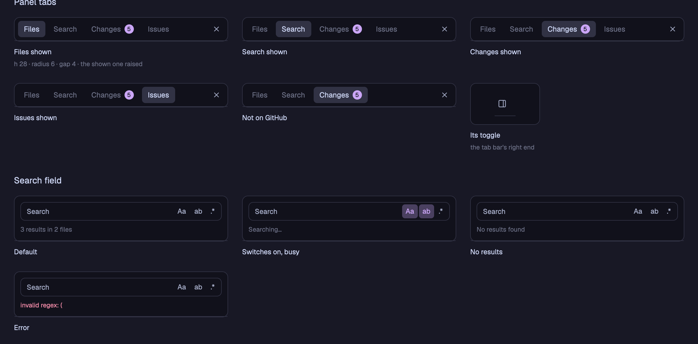

# Styleguide

The Herdr app mod's look, part by part: the foundations it is built on, each component in each of its states, and the
panels they make. The pictures are the styleguide inside the mod itself, drawn by the views' own code from made-up
states, so they show what the mod draws; in the Herdr app, `herdr-app do herdr-fold.styleguide` opens it in a tab. The
colors are the layout's theme, Catppuccin Mocha, as in the TUI.

## Foundations

### Color

| Token | Use |
|---|---|
| `background` | panels and fields |
| `raised` | buttons and chips |
| `hover` | what the mouse is on |
| `selected` | the chosen row |
| `selection` | a match in Search, the ✦ button |
| `border` | frames and rules |
| `foreground` | body text |
| `muted` | icons and captions |
| `dim` | folders, line numbers, authors |
| `accent` | the checked-out commit, branches and tags, the ✦ |
| `solid`, `solid_foreground` | Commit and its arrow, and their words |
| `ansi2` | an added or untracked file, an added line |
| `blocked` | a modified file |
| `ansi1` | a deleted file, a conflict, a removed line, an error |

### Type, shape and size

Body text is 13, a button's words 12 bold, a folder or a caption 11; code (a diff, a hit) is Menlo 11. Panels are
rounded 10, controls 8, rows 6 and chips 5.

### Iconography

The icons are the TUI sidebar's, from one table both draw from (`core/icons.py`): Codicons and each file type's mark
in a Nerd Font when one is installed (the TUI environment installs JetBrainsMono Nerd Font), otherwise the plain marks.

## Components

States are named alike throughout: Default, Hover, Selected, Busy, Asking (a second press to confirm), Error, and how
the part looks without a Nerd Font.

### Buttons

Commit is the one solid button; it keeps its color while it cannot commit yet. A secondary button dims its words when
it cannot be pressed. A row's buttons show only with the mouse on the row.

### Commit

### View tabs and the search field

### Section header and count chip

### File row

### Graph and mode menu

### Diff, problems and empty states

### Search results

### The tab's terminal

## Patterns

## A new part

A new component, or a new state of one, goes into the styleguide in the same change: into
`app/mods/herdr-fold/styleguide.js`, drawn by the view's own method from a made-up state, and its picture here is made
again. See [The Herdr app](app.md) for the mod itself.
