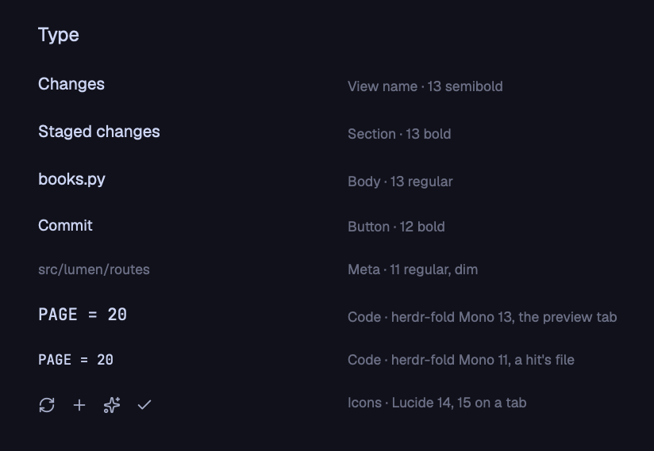
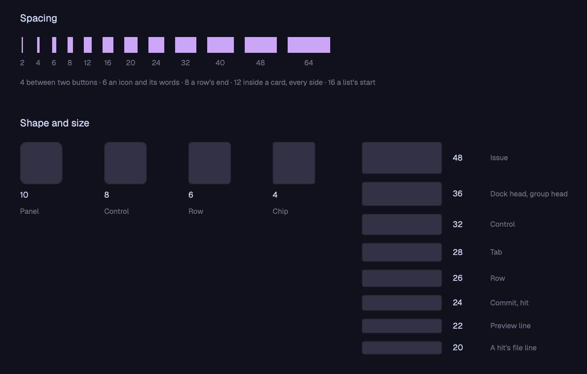
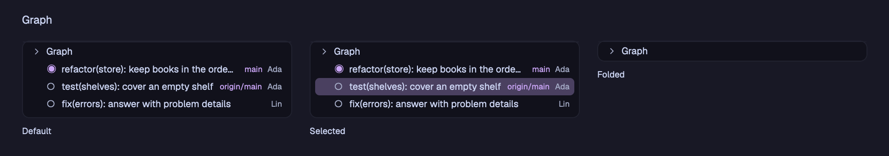
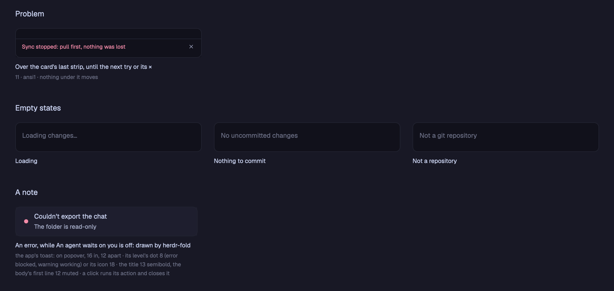
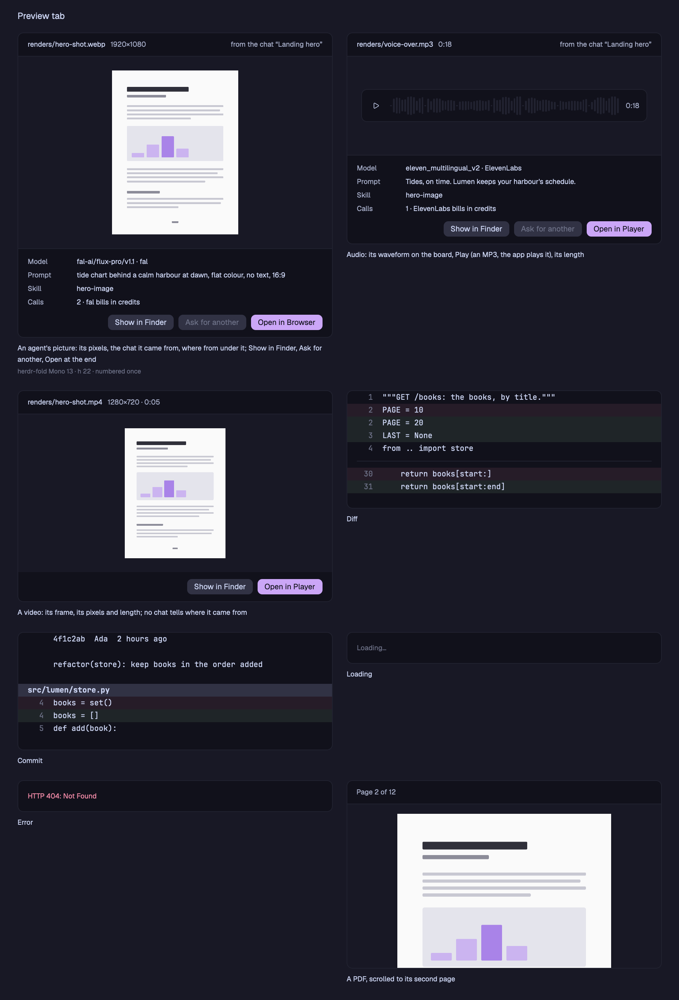
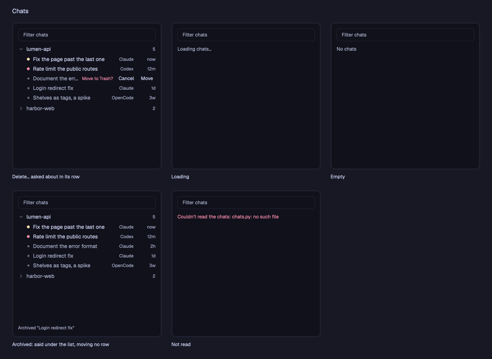

# Styleguide

The Herdr app mod's look, part by part: the foundations it is built on, each component in each of its states, and the
panels they make. The pictures are the styleguide inside the mod itself, drawn by the views' own code from made-up
states, so they show what the mod draws; in the Herdr app, `herdr-app do herdr-fold.styleguide` opens it in a tab: an
index of the parts on the side's level, as Settings lists its sections (180 wide, a row 28, the shown one on the
selection), and the part picked beside it, one part a render (the app stops a render that builds them all). The colors
are the layout's theme, Catppuccin Mocha, as in the TUI.

## Foundations

### Color

| Token | Use |
|---|---|
| `canvas` | the window, behind the cards, in herdr's sidebar color; a well in a card (a command, a source's tag, the context bar, Effort's slider) |
| `chrome` | herdr's sidebar color too: the left sidebar, the bars (the title row, the tab bar, the status bar), the prompt, the person's message, a tool's output, what Claude waits on |
| `surface` | the cards (the chat, the dock, the preview, the terminal, a panel floating beside a rail): the terminals' background, the TUI's panes' color |
| `popover` | menus, the chat bar's panels, tips and toasts: the palette's lightest level, so they float |
| `background` | the terminals and the panes round them: the TUI theme's own |
| `raised` | buttons and chips |
| `hover` | what the mouse is on, a step lighter than `raised` |
| `selected` | the chosen row |
| `selection` | a match in Search, the commit message's ✦ |
| `border` | a control's frame and the rules, between the panel and `raised` |
| `foreground` | body text |
| `muted` | icons and captions |
| `dim` | folders, line numbers, authors, the command field's space name and key |
| `accent` | the checked-out commit, branches and tags, the commit message's ✦, a count's badge |
| `solid`, `solid_foreground` | Commit and its arrow, and their words |
| `ansi2` | an added or untracked file, an added line, an update ready (the status bar's dot) |
| `blocked` | a modified file |
| `ansi1` | a deleted file, a conflict, a removed line, an error |

The app draws its surfaces as the TUI does (`app_theme()` in `tools/build.py`): every card on the terminals' background,
the TUI's panes' color, and the window, its bars and the left sidebar in herdr's sidebar color. In most themes the two
are one color, so the app is flat as the TUI, the cards parted by their 1 px `border`; Catppuccin Mocha's sidebar,
mantle, stands a step lighter than its panes, crust. The popovers stay a step lighter than the cards, on the palette's
lightest level (`LEVELS` in `tools/build.py`, from the theme's own palette and named in its words, with its source);
where that level is the cards' own color, a step lighter is made, 1.05:1 off them (`MIN_STEP`, a test over all 13
themes). Body text, captions (a chip's words on the raised fill too), a count's number on the accent and the words under
the pointer read 4.5:1 at least on what they stand on, in every theme.

| Theme | Cards (`surface`) | Window, bars, sidebar (`canvas`, `chrome`) | Popovers (`popover`) | Popover to card |
|---|---|---|---|---|
| Catppuccin Mocha | crust #11111b | mantle #181825 | base #1e1e2e | 1.14 |
| VS Code (Dark Modern) | #181818 | #181818 | editor.background #1f1f1f | 1.08 |
| Vesper | #101010 | #101010 | input.background #1c1c1c | 1.12 |
| GitHub Dark | #0d1117 | #0d1117 | canvas.overlay #161b22 | 1.09 |
| Tokyo Night | #1a1b26 | #1a1b26 | a step over bg #1f202a | 1.06 |
| Kanagawa | #1f1f28 | #1f1f28 | sumiInk4 #2a2a37 | 1.16 |
| Rosé Pine | #191724 | #191724 | overlay #26233a | 1.16 |
| One Dark | #21252b | #21252b | @syntax-background-color #282c34 | 1.10 |
| Dracula | #282a36 | #282a36 | a step over BG #2c2e3a | 1.06 |
| Gruvbox | #282828 | #282828 | bg0_s #32302f | 1.12 |
| Nord | #2e3440 | #2e3440 | nord1 #3b4252 | 1.24 |
| Solarized | #002b36 | #002b36 | a step over base03 #052f3a | 1.05 |

A source's tag (Global, Project, Local, Managed, Built-in, a plugin's, claude.ai) wears no hue: `muted` on a `raised`
chip (`scopeTag`), the graph's node tags too. Hue is for states (red failed or deny, yellow sign in, ask or a conflict,
green allow or used), levels, the parts of what loads, and the models; the accent for focus, the chosen row, the primary
button and the busy spinner. Text is never `dim` (counts, costs, notes, plan words, resets and budget words are
`muted`), and none is under 11 px.

### Type

Body text is 13, a button's words 12 bold, a folder or a caption 11, a rail's label 10; code is the TUI's
herdr-fold Mono (`CODE_FONT` in `parts.js`, the layout's), 13 in the preview tab and 11 for a hit's file.

### Spacing, shape and size

Padding and gaps keep to a 4 px grid (`SPACE` in `parts.js`: 2, 4, 6, 8, 12, 16 and up): 4 between two buttons, 6
between an icon and its words, 12 inside a card on every side (`PAD`: a terminal's text, a view's words and fields, its
last row at the bottom; a row's hover pad reaches halfway in: a list 6 in, its row 6 more on each side, a tree's indent
on the left alone), 8 over and under the dock's tabs and 6 at their sides. Panels are rounded 10, controls 8, rows 6 and
chips 4. A test checks every padding, gap, text size and corner against these scales.

### Motion

A section, and the Graph, springs open and shut, its height with no overshoot (`spring`, `SPRING` in `parts.js`), and
its chevron turns with it: GPUI turns nothing once, so `fold()` crosses the two chevrons' opacity on the same spring.
The app animates them itself, never the mod's own timer. The TUI turns a fold's chevron through a frame at 45° (⌟)
between › and ⌄, 80 ms long (`Turns` in its `widgets.py`).

### Iconography

The views' icons are Lucide's, drawn by `icon(name)` in the text's color; a file's is Catppuccin Icons' for its type,
in its own colors (`fileMark`), the types told apart as the TUI sidebar tells them (`core/icons.py`); a connector's is
its service's logo, SVG Logos', in its own colors with no tile under it, a one-color dark mark (Linear, Sentry) in the
text's color (`BRANDS` in `icons.js`, from `core/connectors.py`). `tools/icons.py` fetches the three sets from Iconify
into `app/mods/herdr-fold/icons/` (a logo SVG Logos lacks from Simple Icons or its maker's own repository), `icons.js`
names each once, and a test fails on an icon no view draws.

A network's mark (`networkMark`, 16 square unless told, from `NETWORKS` in `core/icons.py`, in the routes' order) is
drawn as a connector's, with no tile: Tailscale's one-color mark in the text's color (its light version on a dark
theme), NetBird's logomark in its own colors, ZeroTier's in its gold. WireGuard and Cloudflare, whose trademark
policies keep their logos out of an application without written permission, show their letter, bold 10 in `muted` on a
`raised` tile rounded 4; the local network, a public address and another tunnel Lucide's `network`, `globe` and
`shield` in `muted`. A machine behind another wears none: its indent says it. In the TUI no glyph is a brand's: its
letter in its color (Tailscale's in the text's, WireGuard's and Cloudflare's `muted`); the others Nerd Fonts' md-lan,
cod-globe and cod-shield, or ⌂, ⊕ (the Earth's sign) and ∩ without icons, `muted` (`network_mark`). Each mark's source
and license are in [THIRD_PARTY_NOTICES.md](../THIRD_PARTY_NOTICES.md).

## Components

States are named alike throughout: Default, Hover, Selected, Busy, Asking (a second press to confirm) and Error.

### Buttons

Commit is the one solid button; it keeps its color while it cannot commit yet. A secondary button dims its words when
it cannot be pressed. A row's buttons show only with the mouse on the row. Every icon button is `iconButton`: 26
square, radius 6.

### Files

As VS Code's Explorer: a row 26 high, each level 12 further in, a file's Catppuccin Icons' icon and git's color and
letter for its state. A new name is typed in its row; ⏎ makes it, esc drops it.

### Repository

### Commit

### Title row

The window's own row, across its whole width over the sidebar and the tab bar, as commands.html's B draws it: 36 high
with its hairline, on the window's level (`canvas`), a hairline (`border`) under it as the status bar has one over it;
it drags the window, and a double click maximizes it. On macOS the traffic lights sit in it, 18 in, on its middle line
(the layout's `traffic_lights`); elsewhere the window's own buttons stand at its end, 8 in, their tips opening to the
left. At the window's centre the command field: 300 by 25, 5 under the row's top, 8 inside and its parts 6 apart, a
hairline round it, rounded 6; the palette's mark (⌘ on macOS, else its search, 14, muted), the shown space's name faint
in it (`dim`, 12) as a placeholder, and the palette's key at its end as bound (`dim`, 11; `herdr-fold.palette`, the
layout's own binding over the global one). Under the pointer it takes the hover fill and the text's color, its tip
`Commands`; a press opens the command palette onto it. While the palette is open the field hands its place over to the
palette's own and is drawn empty: the app keeps a popup 8 under the window's top, so a lit field would show a sliver
above the palette. Narrower than the window leaves it between the lights' room (or the buttons') at both ends, the field
narrows; under 160, the mark alone, an icon button whose tip says the key.

### Command palette

herdr-fold's own, opened onto the title row's field as commands.html's Nyitva draws it: 600 wide on the window's centre
(the window less 8 at each side when narrower), 8 under its top, the nearest the app lets a popup come (Nyitva draws it
at the top), so its field, 25 high and 5 inside, lies over the title row's 8 lower than drawn, the field becoming it:
the mark where the field's is, `Type a command…` in the space's name's place and Esc in the key's (`dim`, 11), a
hairline round it in the inputs' color (`input`), rounded 6, 4 inside the palette's edge. Under it a hairline across the
palette, then the panels' list form (the chat bar's, `menus.js`: the popover's surface, a hairline round it, rounded 10,
lifted; a part's name 11, medium, dim, 8 over it and 4 under; a row 32, 12 in, rounded 6, 2 apart, the keys' row on the
hover fill, the pointer moving it), 384 high at most and scrolled past it, the keys' row kept in view. The rows are the
app's commands as the app's palette names and groups them (Tab, Pane, Space, Layout, Terminal, Agent, Window, App; the
window's own off macOS, a layout each to switch to, a command it has no name for titled from its own), each with its key
at its end as it works in the layout (the layout's own binding, else a global one the layout leaves, else a terminal's);
after the app's groups herdr-fold's own commands in one more, `herdr-fold` (`PALETTE_OWNED`: Settings…, Files, Search,
Changes, Issues on GitHub only, Agent, Chats, New chat as + names it, Styleguide, Mark agent unread, Commit and push,
Write commit message; not the palette itself, nor Commit, whose message is typed in Changes, nor Sync, Changes' own),
rows as the rest. A key is a cap for each part (`keyCap`, 16 high on the row's line, 4 apart, in the text's color on the
keys' row; ⌘ ⇧ ⌥ ⌃ and ↩ ← on macOS, words elsewhere). The first row is lit. Typed, the rows are found as the / menu
finds its own (`slashRank`: a title or command that starts so, then a word of either, then either holding it, then the
words it is known by besides), in one list with no part's name, the best first and lit, each with its group as a muted
tag at its end; nothing found, `No command matches` in the first row's place. Enter runs the lit row, ↑ ↓ move it, Esc,
a press beside it or the key again closes it; a command that needs a name asks for it, as the app's does. There is one
palette: in the layout the app's palette key opens this one.

### Tab bar

herdr-fold's own, in place of the app's, under the title row: a tab 28 high, its × on the active one and under the
pointer, + after the last tab; at its right end, over the dock, the dock's own actions as center-chat.html draws them:
Chats (✦), More (⋯) and » (« while the dock is a rail), » in the row of the left sidebar's own toggle and never moving.
Each is an icon button, 4 apart, its tip opening to the left. Chats' dot (ansi3) says chats wait on you, their number in
its tip ("Chats · 2 waiting"); Chats is in the accent while its list shows. More has no dot (a newer herdr-fold is the
status bar's to say); its menu opens under it, its tip quiet till the pointer leaves it. A dot is 7, centred on the
icon's top-right corner as a count's badge sits, ringed 2 in the bar's fill. With the dock a rail the three stay where
they are, Chats floating its list beside the rail.

### Status bar

The window's foot, herdr-fold's own in place of the app's, as the mockups' `.status`: 28 high on the side's level
(`chrome`) under a hairline, 16 in and its items 16 apart, 12 in the captions' tone. The machine (This computer; another
machine its network's mark 14 before it, 6 apart, none for one behind another), the branch, then the agents behind a 6
px dot: those waiting on you in ansi3 (`1 of 3 agents waiting for you`), else those working in the accent (`1 agent
working`), else how many (`2 agents`) with a dim dot. The machine is a press's too: 20 high, 6 inside (its words where
they were), rounded 4, the hover fill under the pointer, opening the Machines tab on it. While a run works in the
background, `1 run working` after them in the text's color, 20 high, 6 inside, rounded 4, the hover fill under the
pointer, a press opening the Agents tab on Runs. At its end, only while Herdr has one ready, its update: a green dot
(`ansi2`) and `Update ready: herdr-core 0.1.21` or `Update ready: Herdr 0.1.16`, 20 high, 6 inside, rounded 4, on the
hover fill in the text's color under the pointer, its tip saying what a press does (herdr-core updated, the terminals
running; Herdr restarted into it); while herdr-core updates, a spinner in the dot's place and no press. With neither
ready, a newer herdr-fold is the same item, `herdr-fold 0.4.0 is out`: its words say what is true (a press updates
nothing, it opens Settings at About), so they are not Update ready. One item at a time: Herdr, herdr-core, herdr-fold.
It is the mod's one sign of an update.

### The dock's tabs and the search field

The right panel is a dock as the TUI sidebar: one card, its top level with the tab's, its views' text tabs on top
(center-chat.html's: 8 over and under them and 6 at the sides, then a hairline: 45 high, the views' stack's header) over
one view at a time. A tab is as wide as its words: 28 high, 6 inside each side, so the first tab's name stands 12 in as
the views' words under it, rounded 8 as a control, its name 13 in the muted color; the shown one on `raised` in the
text's color, the one under the pointer on `hover`; the tabs stand 2 apart, one control (two separate hover backgrounds
keep 4, `GAP`). Changes' count follows its name, 6 after it, in the accent badge (`badge`): 18 high and at least as
wide, 4 inside each side, its number 11 semibold; Agent, the fifth, wears its agent's own icon (the app's for the
program, 14, 6 before its name; Lucide's `bot` while none is known) and, while its setup has a problem, a dot 6 after
its name, as a tab's state dot: `ansi1` for a failed server, else `ansi3` for one to sign in, the problems in the tab's
tip; a count is short when large, as the TUI's: as it is
to 999, then 1.2k, 18k, 1.3m, four characters at most (`shortCount`). While the Chats list shows in the view's place no
tab is shown, Chats at the tab bar's end lit instead. Past the card's width the last tabs leave, never the shown one
(`tabFit`, each tab's width as drawn). The tab bar's » folds the dock to its rail, and the dock is open or a rail, never
hidden. On the rail a count sits in a smaller badge on its icon, as VS Code's activity bar has it (`countBadge`): 14
high, its number 10, its centre on the icon's top-right corner, out of the flow, so a count coming, going or growing
moves no icon. More, at the tab bar's end, opens its menu under it: the views with their checks, a rule, About
herdr-fold.

### The panel folded to its rail

Folded, the dock is a rail of its views' icons (Agent's Lucide's `bot`, a problem of its setup a dot on its corner as
a folded side's state dot: 9, ringed 2 in `chrome`, red over yellow), those hidden in More's menu left out, as the
left sidebar folds (Chats and More stay at the tab bar's end), on the side's level as it (`chrome`, rounded 10, its
first icon 8 in, level with the left dock's); a press floats a view beside it every time, as wide as the dock, 8 left
of the rail and level with the centre card's top (under the tab bar), its icon lit meanwhile as Terminal's while it
shows, the keys in it (Esc, its icon again, its × or a press beside it closes it, never one in a menu it opened; another
rail icon, Terminal, «, More or ✦ closes it and does its own at once; Esc in its view's field or list is that view's
first), its head dragging it, the grip at its foot sizing it
(12 high, a 24 × 4 bar in the border's color, muted under the pointer, the accent while dragged, the resize cursor; its
head and three rows at least, the rail's height at most, a double click its tallest or back); Chats, from the tab bar's
✦, floats with its filter taking the keys, ✦ lit. Terminal shows or hides
the tab's terminal under the tab, a card 8 under the tab's, the centre's width, 240 high at first and as dragged after
(as VS Code's panel); while it shows, Terminal is lit: the selected square, its icon and name in the accent. A tab with
no terminal shows no card there, Terminal unlit with its tip.

### Section header and count chip

### File row

### Graph

### Menus

Every menu is a popup (`Menus` in menus.js), as the app's own: under the button that opened it, its right edge with
the button's, above the button where it does not fit under it (the chat's bar), or at the pointer for a right
click; it lays over what is below it, and a press beside it closes it. The TUI's menus open the same way.
A button that opens a list to choose from (Commit's modes, a new chat's agent) carries ⌄ at its right end;
one that acts at once carries none, nor do the chat's model and mode chips, as center-chat.html draws them. A rule
parts a menu's kinds of line, as the dock's More its views from About herdr-fold. A line that opens a window ends in
…, but About.
A line's note stands at its end, 11 in `muted`, or in its tone's color (a new chat's agent to `sign in`: `ansi3`).
A line that cannot be chosen now stays in its place in `muted`, its tip saying why (a running chat's Delete…).
A filter's menu (Issues', Pull requests') is in groups: a group's name 11 `dim` on a 14 line, 6 over and 2 under it,
where the checks stand; each value's words on one column after its check (14) and its mark's slot (14: a dot 11, an
icon 14, centred), its count 11 `dim` at its end, a zero `dim` all through and in its place; it stays open while values
are pressed, its rows made anew (`MENU_LIVE`), opened again where it stands when it needs another height. A right
click's Priority… and Type… open a second menu in its place: its head the issue's number and title, what it sets at its
right, a rule, `No priority` at the marks' column.

### Problems and empty states

What a list says instead of rows (loading, none, its own failure) stands in its first row's place, and the rows take it;
what was done or went wrong stands under the list, on the card's foot (`footNote`: 12 in, 6 over it, 11, dim, a failure
ansi1, wrapping), as the TUI's last row: a done thing goes after four seconds (`NOTE_MS`), a failure stays until the
next. Neither moves a row. Changes keeps it over the card's last strip instead (opaque, a hairline over it, × to
dismiss), so its Graph never moves; its composer is always two rows: the push offered is said in the empty field, the
issue the next commit fixes is a chip at the field's end, and a commit, a sync, a pull or a push under way turns ↻ into
a spinner whose tip names the step, Commit keeping its words.

A note herdr-fold draws itself, an error or a warning while Settings' An agent waits on you is off, is the app's own
toast: on popover, 16 in, its parts 12 apart; its icon 18, else its level's dot 8 (error `blocked`, warning `working`);
the title 13 semibold, the body's first line 12 muted; a click runs its action and closes it.

### The Agent panel

The dock's fifth view, as center-chat.html's Agent panel: an agent's setup as layers. The words are core's
(`agent_layers.py`'s `layers()`), the TUI's Agent view's too; the view keeps the layout (`agent.js`, its rules in
`layers.js`).

| Part | Measures |
|---|---|
| Head | 12 in and over it, 6 under: the agent's icon 14, its name 13 semibold, `in lumen-api` in `muted`, 6 apart; the filter's icon button at its end; under it the head's line 12 in `muted` (`Opus 5.5 · High · starts at 34.2k of 1M`), its model and effort a press (4 in, rounded 4, the hover fill, the accent's 14% while their form is open), the problems' chips 18 high at its end, a press choosing its row; a file it could not read 12 in `ansi1` under it, the file its tip |
| Bar | 12 in, 8 under, a hairline under it: 6 high on `canvas`, its parts 2 apart, each as long as its share, rules the accent, skills `ansi6`, connectors `ansi4` (`partColor`, the Context panel's too); no legend |
| Section head | 28 high, 6 in, rounded 6, the hover fill under the pointer: the chevron 14 in `dim` (`fold`; none on an empty section, its room kept), its title 12 semibold, its count 11 in `muted`, 6 apart; at its end Permissions' summary 11 in its tones, Connectors' +, and the cost 11 in `muted` in a column 52 wide after its part's swatch 7 square, rounded 2 |
| Row | 26 high, 10 in, 12: its mark in a column 12 (✕ 12 in `ansi1` failed, a 6 dot in `ansi3` to sign in or a conflict, in `ansi2` used), a connector's logo 16 (no other row an icon), its name (one that does not run here in `muted`), its note 11 in `muted` (a subagent's model and tools in the states' column), both agents' icons 12; then its state 11 in its tone, its tag (`scopeTag`: 11, 16 high, 6 in, rounded 4, `muted` on `raised`, never a hue) in the section's one column, its cost 11 in `muted`, right-aligned in 52; a group's head (Hooks) 22 high, 11 in `muted`, from the names' column, rounded 6, its state (`off here`) at its end; Claude's a press choosing it, as a row |
| Conflict | 40 high: its yellow dot, the rule, and its sentence under it, 11 in `ansi3` |
| `11 more` | 24 high, 11 in `muted`, from the names' column (28 in); the hover fill, rounded 6 |
| Usage | the first section, its head a section's with no count; folded, its figure before Open Usage, 4 apart: the agent's icon 14, 6, then its words 11 in `muted` and its figure semibold in its level's color; a row 26 high, 10 in, a press choosing it: its mark's room 12, the agent's icon 14, its name, its plan 11 in `muted`; at its end each window in a column 74 wide, right-aligned: `5h` or `wk` 11 in `muted`, its bar 22 × 4 on `raised` in its level (`levelFill`, 3:1), its percent 11 semibold in its level's color (`levelInk`, 4.5:1), `–` in `muted`; a model's own week after them in a column 90 wide, its name in the label's place, the first part to go: from 364 px, the plans' words beside it from 392, a row without one keeping its room so the columns stand under each other; an API key its month's figure semibold in its level, `of $150` in `muted`; under a row only while yellow or red, 20 high, 11 in `muted` from the names' column: its reset, or the pace; under 300 px the bars go |
| Open Usage | at Usage's head's end: 22 square, rounded 6, Lucide's external-link 14 in `muted`, `raised` under the pointer, its tip `Open Usage` |
| Chosen row | a press chooses a row: the hover fill under the pointer, the chosen one on the accent's 14% of the card (`chosenFill`), its state's word read on that |
| Properties | under the layers, on the side's level (`chrome`) with a hairline over it, 12 in, its parts 6 apart, 12: the title 20 high (a connector's logo 16, its name semibold, its state 11 at the end, 8 apart); a line 20 high: its label in `muted` in a column 64 wide, cut, 8, its value in the code font 11 (a phrase, `Used`, `On`, `Plan`, `Read`, in the text's), a third column in `muted` at the end; the built-in subagents' a list, each name and its model and tools in `muted`; the error 8 and 6 in, rounded 6, the code font 11, `ansi1` on its 8% of the level (`errorColors`), the files it named its tip; a rule's first lines in the code font 11, `muted`, a line 16, each cut; a description 11, `muted`, three lines at most |
| Actions | 8 under the rest, 6 apart, wrapping: 26 high, 12 in, rounded 8, 12; the first on `raised`, the others plain in `muted`, the hover fill under the pointer; while Claude checks a server, `Checking…` faint and the state a spinner 12 in the accent, on its row too |
| Connector | its row's and its properties' mark is 16 square in the icon's place: the service's logo, or for one of no known brand, or one whose maker gives no logo (FLUX, Meshy), its letter 10 bold in white on a tile rounded 4, in a space's avatar's colors by its name (`tile`); a known service's row named as its maker writes it (`fal`, `ElevenLabs`), its config's name a `Name` line |
| Media service | its note what it makes (`voice`, `image, video`), its state its calls today in `muted` in place of its tools (`7 calls today`, `no calls today`), no cost in the costs' column; `Loads` in its properties |
| Signing in | the row's state `signing in` in the accent after a spinner 12 (Lucide's loader-circle, a turn in 0.9 s); in the properties a line 20 high, the spinner and `Finish in your browser`, 8 apart, then `Open the page again` raised and `Cancel` plain |
| Buttons | `Connect` is the one solid button (`solid`, 12 bold); else the first is on `raised` and the rest plain in `muted` (`actionLook`); one that cannot be pressed while its command runs is in `muted` with no hover |
| Add | Connectors' +, and Permissions' (a new rule: lit while its form is open): 22 square, rounded 6, Lucide's plus 14 in `muted`, before the costs' column; `raised` with a hairline in the accent while its menu is open. The menu 4 under it, its right edge with the button's, 200 wide, the panels' form (`panelSurface`, `panelRow`: a row 32, its icon 16 in `muted`): `From claude.ai…` under external-link, `By URL…` under link, then each offered service not added yet under its logo 16 (`fal`, `ElevenLabs`, `FLUX`, `Runway`, `Figma`), the form filled |
| Add form | in the properties' place, their level and padding, 6 apart: the title 20 high (Lucide's link 14 in `muted`, `Add a connector` bold); a field's line 28 high, its label in `muted` in the properties' 64, the field rounded 8 on `canvas` with a hairline, 8 in, the code font 11; the one with the keys edged in the accent, a refused one in `ansi1` with why under the fields, 11; For a two-part switch on `canvas`, 2 in, rounded 6, a part 20 high, 6 in, rounded 4, the chosen one on `raised`, the other in `muted`; `Add and connect` solid (`Adding…` while its command runs), `Cancel` plain |
| Agent chip | the head's: 26 high, 6 in, rounded 6, its parts 6 apart (the icon 14, the name semibold, `in lumen-api` in `muted`, ⌄ 12 in `dim`); the hover fill under the pointer, `raised` with a hairline in the accent while its list is open |
| Agents' list | a popover 4 under the chip, 300 wide, the chat bar's panels' form (`panelSurface`, `panelRow`): a group's head 12 semibold in `muted` (12 in, 6 over, 4 under), a row 32 (✓ 12 in the accent on the one shown, whose row stands on the accent's tint, the agent's icon 16, its name 13, cut where long, 8 apart), at its end its plan's word 12 in `muted`, or `sign in` in `ansi3`; a rule, then `Not installed`: its rows in `muted`, the icon at 0.6. The words are core's (`agent_state.py`'s `listed()`), the TUI's too; narrower than 312 the list is the panel less 12 |
| No setup to show | in the layers' place, centered, 24 in, 8 apart: the agent's icon 28, the title 13 semibold, the words 12 in `muted`, 272 wide at most, a line 18; an install line in the code font 11 on `canvas`, 28 high, rounded 6, Copy its icon button (a check for 2 s once copied); Sign in 26 high, 12 in, rounded 8, 12 bold on `solid`; `Open its page` 12 in `muted` with Lucide's external-link 12; the last line 11 in `muted` |

| Form | under the row's lines (one with no row, the head's, the +'s, Hooks' head's: alone in the properties' frame), the properties' 6 apart, core's words (`harness.py`'s plan): a line 28 high, or as high as its control wraps, its label in `muted` in the lines' 64 (none on a form of one control); a switch 28 × 16 at its line's end (`toggle`); a field as the add form's (28 high, rounded 8, the code font 11 on `canvas`, the keys' one edged in the accent); a sandbox's hosts over its field, a line 20: the host in the code font 11, its layer's tag, × 16 square with Lucide's x 12 in `muted` (none on one a rule gives or the organization's); a conflict's ways a list, a row 26 high, 8 in, rounded 6, ✓ 12 in the accent on the chosen one, which is on `raised`, semibold; a hint and a note 11 in `muted`, a sentence; one that cannot be changed is that note alone |
| Parts | a choice of a few as one control that wraps, the add form's For too: on `canvas`, 2 in and apart, rounded 6; a part 20 high, 6 in, rounded 4, the chosen one on `raised`, the others in `muted`, one core greys in `dim` with why in its tip |
| Saved in | once a control is touched (a rule's always): the label, the layers as parts, then the chosen one's file in the code font 11, `muted`, the text's color under the pointer, a press opening it; 6 apart, the file wrapping under the parts in a narrow panel |
| Change | 8 and 6 in on `canvas`, rounded 6, 11, a line 16: core's lines in the code font, one taken out after `−` in `ansi1`, one put in after `+` in `ansi2` (each 4.5:1 on it), the file's path in `muted` over its lines where no layer is offered or two files change; 4 under them when it applies in `muted`, the text's font |
| Warning, refusal | 11, a line 16, a sentence: a warning in `ansi3`, a refusal in `ansi1`, each 4.5:1 on the level |
| Form's buttons | the row's own while its form is untouched, then `More options` and `Remove` plain; touched, in their place `Cancel` plain and the one solid button at the row's end (core's word), at half strength while nothing can be saved; a removal's question 12 semibold over its line |
| Foot | after a save, under the properties: 32 high, 12 in, a hairline over it, on the side's level; what was saved 12 in `muted` (a written line in the code font 11), cut; `Undo` semibold at its end; a way back refused in `ansi1` in the words' place |

A tone is one color everywhere (`toneColor`): failed and deny `ansi1`, sign in and ask `ansi3`, allow `ansi2`,
connecting the accent, off `dim`, any other state `muted`; as small words it is moved toward the text until it reads
4.5:1 on the card, a chip's fill, the chosen row or the properties' level (`toneInk`, `chipColors`; a test over all 13
themes), as a source's tag is. A problem's chip is pressed: 6% more of its tone under the pointer (`CHIP_LIFT`), and it
chooses its row. A row's properties repeat no line their own title says (a subagent's model, a rule named after its
file: `propertyLines`), as the TUI's leave out what the row shows; only what this client does has a button, Claude's
own commands on Claude's rows alone (`doable`). A
section's rows spring open under its head (`SPRING`), each view's slides its own. The tags' column is as wide as the
section's widest tag, twelve characters at most (`tagRoom`), so its states stand in one column before it; under 300 wide
the tags leave. What it says instead of rows (loading, the read's failure in `ansi1`) stands 12 in, 12,
in the first row's place; where an agent stands with no setup to show (not signed in, not installed) is
core's words (`standing()`), the TUI's too; one whose setup is not read has its head alone. The agents' list holds
the installed agents first, the ones not installed dim under their own head, and never an e-mail: a plan
shows as its word, or not at all. What core could not read is said in its place, never left out: Connectors with no
list of its servers is one dim row, `not read`, no count, why in its properties.

Usage is a meter list, its words core's (`usage.py`'s `section()`), the TUI's too. A percent's level is the status
line's: under 50 `ansi2`, from 50 `ansi3`, from 80 `ansi1` (`levelColor`); the level is never the only sign, its number
stands beside it (a folded row's figure is that number in its color, no dot). The agent in use is open, the others
folded to their row; each dollar figure herdr-fold computes wears `~`, a budget none. As small words the color is
moved toward the text until it reads 4.5:1 on the card or the lit row (`levelInk`), as the bar's fill until it is seen
3:1 on its track (`levelFill`; a test over all 13 themes for both).
The track is `canvas`, not `raised`: on `raised` six themes' red or green falls under 3:1. A window past its reset
shows nothing in its column, the other keeps its own; the bar and the reset are then the week's. With no agent's limits
known it says `Not known yet` in the first row's place, 11 in `muted`; a failed read says why there, in `ansi1`. The
agent shown with no reading keeps its row: `limits not told` at its end, 11 in `muted`, why in its properties.

### The Agents tab

The main area's tab of that name, one a space, under Lucide's share-2 in the tab bar: usage.html's head, its Graph
(agent-graph.html's Wiring and This chat), its Usage (usage.html's Riport) and its Runs (runs.html's). The nodes, the
edges, the figures, the runs and every word are core's (`graph.py`, `costs.py`, `report.py`, `runs.py`); the views keep
the layout (`agentstab.js`, `usageview.js` and `runsview.js`, their rules in `graph.js`, `report.js` and `runs.js`).
The styleguide's parts are `agents-graph`, `agents-usage` and `agents-runs`, each in two halves.

| Part | Measures |
|---|---|
| Head | on the card, 12 in and over it, 8 under: the scope's chip 26 high, 6 in, rounded 6 (the agent's icon 16, `Claude in lumen-api` 15 semibold, ⌄ 14 in `dim`, 6 apart), the hover fill under the pointer, `raised` with a hairline in the accent while its list is open; the list the Agent panel's agents' list, the agents core reads alone; 12 after it, where a chat was read, the graph's views as a switch (`segmented`: Wiring, This chat); at the head's end the tab's three views, Graph, Usage and Runs, 16 apart: 13, 26 high, the shown one in the text's color over 2 px of the accent, the other in `muted` |
| Switch | `segmented` in `parts.js` (usage.html's `.seg`): 26 high on `canvas` with a hairline, 2 in, rounded 8; a part 8 in, rounded 6, 12 in `muted`, the chosen one on `raised` in the text's color, the hover fill under the pointer |
| Canvas | 12 from the card's sides and foot: a hairline frame, rounded 10, on `surface`; dots 2 square, 20 apart, in the text's color at 5%; scrolled both ways where the graph needs more room |
| Columns | their names 11 in `muted`, 48 down: In from the left edge, Agents over the agent, Uses to the right edge; the first node 80 down, 24 from the sides; two nodes 12 apart, two groups (rules and skills, tools and connectors) 32; the agent on the middle, its subagents 48 under it, 16 in, 12 apart; In and the agents 96 apart, the agents and Uses as far as the widest edge's gates need, so no gate lies over a node (`gatesRoom`: 96 to 528); a canvas too narrow for that brings both nearer, to 48 and the gates' own room (`gatesRoom`'s tight one), before it scrolls; with nothing going in, the agent from the left edge |
| Node | on `chrome`, a 1 px line in the edges' color, rounded 10, lifted (`shadow_md`), 8 over and under and 12 in, 190 wide at least (the agent 250, a subagent 230), 300 at most: its icon 14 in `muted` (a connector's logo or letter tile 16, the agent's own icon), its title 12 semibold, its source's tag 11 at its top right in the tag's color read 4.5:1 on the node (`tagInk`), cut at twelve characters; 2 under it its line 11 in `muted`, 16 high |
| Agent's node | its fill the accent's 6% of `chrome`, its edge the accent at 60%, its line in `muted`; its chips 6 under: 18 high, 6 in, rounded 4, the code font 11 in `muted` on `canvas`, 4 apart |
| A node's state | failed: its edge `ansi1` at 60%, its line in red; to sign in: its edge `ansi3` at 50%, its line in yellow (`toneInk` on the node); one that does not run here at half strength, with no edge |
| Chosen node | ringed 2 in the accent, drawn over the others; under the pointer the grab hand, the closed one while it drags |
| Edge | 1.5 wide, from a node's right to the next one's left as a cubic with handles 120 long (half the way where closer), a node's edges leaving it 4 apart in their targets' order; a subagent's straight down from its agent's foot, 24 in from its own left; always solid in `muted`; on demand dashed 5 and 5; waiting dashed in `ansi3`, failed dashed in `ansi1`; each color moved toward the text until it is seen 3:1 on `surface` (`wireColor`) |
| Gate | pills centred 55% along their edge, over the nodes: 18 high, 6 in, rounded 4, a hairline, on `canvas`, 11, 4 apart; ask in `ansi3`, allow in `ansi2`, deny in `ansi1`, a hook in the accent, each read 4.5:1 there (`toneInk`) |
| Legend | at the canvas's top right, 12 in: 26 high, 12 inside, rounded 8, a hairline, `chrome` at 90%; a sample 22 wide and 2 high (dashed: three 5 px pieces), its word 11 in `muted`, 6 apart, the kinds 12 apart |
| This chat | what ran at full strength, the rest at half (`faded`), its edges in their colors at 35%; an edge that ran 2 wide in the accent, the one a call waits on 3; gates on the edges that ran alone; a first use's number a disc 18 across in the accent, 11 bold in the accent's own text color, its centre on its node's top right corner (`badgeAt`); at a node's top right its cost 12 in the text's color, or its calls 11 in `muted`, in the tag's place; a model's square 8 with corners 2 before the line, 6 apart; the share a bar 4 high, 6 under the line, round-ended, its track `raised`, its fill the model's color; the legend gains `ran here`, its sample in the accent |
| What a node ran | the properties 340 wide, the cost with its word 12 at the title's end; a line 20 high, its label in `muted` in a column 82 wide, its value in the text's font, the value's note in `muted` after it, 8 apart; `Open in Usage` a plain button, `Show in Agent` after it |
| Properties | at the canvas's lower left, 12 in: a popover 300 wide (`popover`, a hairline, rounded 10, `shadow_lg`), 12 inside, its parts 6 apart, 12: the title 20 high (the node's mark, its name semibold, its state 11 in its tone, × 16 square with Lucide's x 12 in `muted`, 8 apart); a line as the Agent panel's (`propertyLine`), its label in a column 70 wide; a folded node's names as a list, a line 20, the name left and its source or gates right in `muted`, 240 high at most, scrolled past it; the error as the Agent panel's; Open as its buttons (`actButton`), and last `Show in Agent`, plain (raised where it is the only one), on a node the Agent panel has a row of and on the agent's own |

Usage is one column, 1000 wide at most and centred, the head scrolling with it, its blocks 20 apart.

| Part | Measures |
|---|---|
| Filters | one row, 12 apart, wrapping: the periods and the agents each a switch (`segmented`); at the right `Reading chats…` 11 in `muted` after a spinner 12, `Budget…` and `Export CSV` as plain buttons (`actButton`), `Budget…` raised while its popover is open |
| Summary | one frame on `chrome`, a hairline, rounded 10; a cell 16 and 12 in, a hairline at its left, the first 1.4 times as wide as the others: its key 12 in `muted`, its value 20 semibold on a 28 line with its unit 12 in `muted` 6 after it on its baseline, its line 12 in `muted`, wrapping, a pace over its budget medium in `ansi3` as words read it there (`toneInk`) |
| Chart card | a hairline frame on `surface`, rounded 10, 16 and 12 in, its parts 12 apart: the title 13 semibold, 16 after it its note or its legend 12 in `muted` (a swatch 8 with corners 2, 6 before its name) |
| Per day | the plot 180 high, a hairline under it; ticks 11 in `muted` right in a column 40 wide, a clean step, four at most (`ticks`), a hairline across at each at half strength; a column 70% of its day's room, 24 at most, its models from the baseline up, the costliest first, 2 px of the card between two segments, the top one's upper corners 4; the days' names 11 in `muted` under their columns, every few past ten, today's always |
| A day's tip | beside its column, 20 from its middle, 8 down: `popover` with a hairline, rounded 8, 12 and 8 in, 168 wide at least, lifted; its date and sum 12 semibold, a row a model (swatch, its name in `muted`, its cost medium at the end), 2 apart |
| Month | 170 high: ticks as Per day's; the budget a 1 px line in `muted` with `Budget $50` 11 over its left end; what was spent a 2 px line in the agent's model's color, the pace on to the month's end the same at 40%, its words 11 in `muted` 20 from its end; today's point 8 across in that color, ringed 2 in `surface`, `$18.40 today` 12 beside it; the month's first and last day 11 in `muted` under the plot |
| By project | a row 32 high: the name in a column 90 wide, 12, the bar 16 high in `muted`, its right corners 4, as long as its share of the largest in 70% of the room, its value 8 after it; core's note 12 in `muted` under the rows |
| Table | a hairline frame, rounded 10: its head 36 high, 12 in, the title semibold and core's note 12 in `muted` at its end, a hairline under it; the columns' names 11 in `muted` on a line 28 high with a hairline under it; a row 32 high, 12, its columns 8 apart, the first taking the rest (160 at least), the numbers' right-aligned, a faint line between two rows; a figure's short word (`value`, `spent`) in `muted` 6 after it; a chat's models as marks 6 by 12 with corners 2, 2 apart; the hover fill under the pointer, the row asked for on the chosen fill (`chosenFill`); narrower than its columns, scrolled sideways |
| Budget | a popover 300 wide under `Budget…`, its right edge with the button's (`popover`, a hairline, rounded 10, 12 in, 8 apart): `Monthly budget` semibold; a field's line 28 high, the agent's name in `muted` in 72, the field on `canvas` with a hairline, rounded 8, `$` in `muted` before what is typed, `a month` in `muted` after it; why a field was refused 11 in `ansi1`; Save raised, Cancel plain |

Runs is one column, 1000 wide at most and centred: the head, then the list's frame (a hairline, rounded 10) down to
the tab's foot, the chosen run's properties or New run's form at its foot as the graph's under its canvas. Its pictures
are yet to be taken (`agents-runs-list`, `agents-runs-new-run`).

| Part | Measures |
|---|---|
| Bar | 8 and 12 in, a hairline under: the agents a switch (`segmented`), New run at its right end, the view's one solid button (`button`) |
| Row | 30 high, 12 in, its columns 8 apart: the mark 14 (a spinner 12 in the accent while it works, the waiting dot 7 in `ansi3` while it needs you, ✕ 11 in red for one that failed, none for one done), the run's name taking the rest (160 at least, then the columns scroll sideways), Agent 56, Folder 90, Started 48 and Made 100 in `muted`, `failed` in red, Cost 56 right-aligned; the columns' names 11 in `muted` on a line 26 high; a day's name 11 semibold in `muted`, 12 over its first row; the hover fill under the pointer, the chosen run on the chosen fill (`chosenFill`); its tip its whole name, its folder and what it made |
| Foot | 12 in `muted` over a hairline, 12 in, wrapping: that scheduled cloud runs are not listed, then `Claude's routines` in the text's color over a faint underline, a new chat with `/schedule list`; what could not be read in red under it |
| Properties | on `chrome` under a hairline, 12 in, 4 apart, 60% of the frame at most and scrolled past it: the title 13 (the run's mark, its name semibold, its state 12 at the end in `muted`, red for one that failed, × 20 square); a line 12, its label in `muted` in 64, its value wrapping; the files in the code font 11, six at most and how many more; a picture 112 wide at 16:9, rounded 6, its name 11 under it, a press opening it in the preview; buttons (`actButton`) h 26, 8 apart, wrapping, raised, `Open PR`, `Open on the web` and `Remove` plain; what a press did 11 under them, the agent's words in red |
| New run | the properties' place and look: `New run` 13 semibold; Agent, Where, Env and When switches (`segmented`, a choice that cannot be greyed: Codex's schedule, the cloud with no environment); the folder the space's; the prompt a textarea on `background` with a hairline, rounded 6, 3 to 8 rows; what the choices do in `muted`; the agent's words in red where it did not start; Cancel plain and at the right end Start run or Open in a chat, the form's one accent, lit once there is a prompt |

Charts follow the dataviz rules the mockups were drawn to: thin marks, a hairline grid, a legend for two or more
series, text in the text's tokens (never a model's color), a model's color following the model wherever it shows, no
second axis. A report of 200 chats and 30 days draws in 10 ms of script, a week's in under 1 ms (measured in
the demo app with a timer round its draw). Nothing in Usage is measured: a place across is a share of its plot.

What it says instead of a graph (loading, an agent not installed, the read's failure in red) stands 12 in, 12, under
the head; Usage the same (`Loading usage…`, the read's failure, `Reading chats…` while nothing is read
yet, core's `Nothing used in this period`), and with no model that has a price it shows no chart, the tables alone;
Runs the same (`Loading runs…`, the read's failure, `No runs yet: New run starts one in the background`).
A graph of 48 nodes and 72 edges draws in 9 ms of script (measured in the demo app with a timer round its
draw): the dots are one dashed path, each kind of edge one path, a node six elements. Nothing moves by itself: a
node follows the pointer while it drags.

### The Machines tab

The main area's tab of that name, one a window, under Lucide's waypoints in the tab bar: graph.html's App frames
(Wiring, a network down, two routes), the Agents tab's canvas, nodes and edges with four columns. The nodes, edges,
properties and every word are core's (`machine_graph.py` over `networks.py`'s look); the view keeps the layout
(`machinestab.js`, its rules in `graph.js`). The styleguide's parts are `machines-graph` and `machines-inspector`; their
pictures are yet to be taken.

| Part | Measures |
|---|---|
| Canvas | the tab's whole card, on `surface`, dots as the Agents tab's; Refresh at its top left, 12 in: a properties button (`actButton`) raised, 26 high, `Checking…` and faint while the status check runs, its tip what it does and when the graph was looked at; a look that failed while a graph shows says why 12 in red beside it, 12 apart |
| Legend | the Agents tab's, at the top right: direct (solid), relayed (dashed), standby route (three dots 2 wide, 4 apart, at 55%), away (dashed red) |
| Columns | their names 11 in `muted`, 48 down, each over its column's left edge: This Mac, Networks, Machines, Through (only while a machine is behind another); the first node 80 down, 24 from the left; each column's left edges in one line; two columns as far apart as the widest label between them needs to stand 8 clear of both (96 at least), spread to 180 where the canvas has room, then the canvas scrolls; the machines in core's order 12 apart, a network's 32 from the next one's; a machine behind another from its jump host's height, 12 under the one above; a network beside its machines' middle, one with none after those with some; This Mac beside the networks' middle |
| Node | the Agents tab's: on `chrome`, rounded 10, 8 and 12 in, 190 wide at least, 300 at most; its mark 14 (This Mac's monitor, a network's mark, a machine's server in `muted`), its title 12 semibold, its tag 11 in `muted` at its top right (a system; a network's state, `signed out` in `ansi3`); its line 11 in `muted` in core's tones (`Codex waiting` `ansi3`, `unreachable` `ansi1` with its edge); This Mac on the accent's 6%, its edge the accent at 60%; a node at half strength while its network is not on; chosen, ringed 2 in the accent, a border, so a node at half strength shows no fill through it |
| Edge | the Agents tab's (1.5 wide, a node's edges leaving it 4 apart); direct solid, relayed dashed 5 and 5, away dashed in `ansi1`, a machine's other route dotted 2 and 4 in the faint line at 55% (`#8c`), no label; a chosen machine on two routes or more, its route in use 2 wide in the accent, over the others (graph.html's Két út) |
| Label | at its edge's middle (graph.html's `.lab`), as a gate: 18 high, 6 in, rounded 4, a hairline, on `canvas`, 11 in `muted`: the way and the time (`direct 12 ms`, `relayed`, `19 ms`) |
| Properties | at the canvas's lower left, 12 in, as the Agents tab's (graph.html's `.insp`): a popover 300 wide (a hairline, rounded 10, `shadow_lg`), 12 inside, its parts 6 apart, 12: the title 20 high (the node's mark, its name semibold, its state 11 in its tone: `connected` `ansi2`, `unreachable` and `off` in `muted`, × 16); why it is away in `ansi3`, wrapping; what to do in `muted`, a command in a box 26 high, 8 in, rounded 6, a hairline, on `canvas`: its words, the command in the code font 11, `Copy` in `muted` at its end (`Copied` a moment); a line 20 high, its label in `muted` in 70, a route's network mark 12 before its value, a fingerprint in the code font 11, the way behind another with `›` in `dim` and its network's mark 12, what it says at its right 11 (`in use`, `3 ms` in `muted`, `standby` in `muted`) |
| Buttons | properties buttons (`actButton`) 26 high, 6 apart, one row (the TUI view's): Status, Set up again, Check again and a network's `3 machines to add` raised, Remove… plain, then a machine's ⋯ 26 square, its menu (`panelSurface`, 220) over it with Show in Spaces and, on a Linux or macOS machine, Look around from here…; Remove… asks first in their place (`Take build-01 off the list, and herdr-fold off it?` 12 in red, Remove raised, Cancel plain); without the package's `machines.sh` the actions that need it faint, their tip saying why |

What it says instead of a graph (`Loading machines…`, the look's failure in red) stands 12 in, 48 down, under Refresh.

### Issues

An issue's number takes its priority's color, as the TUI's traffic light: urgent and high red, medium yellow, low green;
without one, the accent. Its type is a shape, never a color: Lucide's bug, lightbulb or clipboard-list, 16 in `muted`,
in a column 16 wide centred on the title's 18 line (1 over, 1 under), the column there only while an issue listed has
one; a closed issue's marks all `muted`. The funnel at the field's end is 24 square in the field's 30 (3 over and
under), its icon 14 (5 round), in the accent while a filter is on, on the hover fill while its menu is up. A chip of
what is on is 22 high on `raised`, rounded 6, its words 12, 8 in and 6 after its mark (14); its × 12 in a 16 square (3
over and under), 6 after the words, 4 from its end; Clear 12 `muted` at the row's end. A change made says so under the
list with a check in `ansi2` before its words (12, centred on their line), in the text's color. Closing or reopening
asks on the row first. Loading moves nothing and says so once:
the head stays as it is, a refresh of a list shown turns Refresh into a spinner of its size, and the first load, a
failure or none found is said in the first row's place (48 high, the words 12 in, dim, a failure ansi1), which the
rows then take.

### Pull requests

The Issues tab's switch (Issues | Pull requests) is a choice of two, never the accent: Open and Closed below it keep
the screen's one. A pull request's row is an issue's, 48 high: its checks' mark in a column of 14 (Lucide's check
in `ansi2`, a dot in `ansi3` while they run, Lucide's x in `ansi1`; the check and the x 12, centred), its number in
`muted`, its title; its review's state one word at its end (your
review `ansi3`, as it waits on you; changes requested `ansi1`; approved `ansi2`; Draft a neutral tag, 18 high,
`raised`, 11 `muted`); its branch, author and age 11 `dim` under them, the checks too unless they passed. Changes'
row of the branch's pull request is 32 high under the repository, a hairline round it on `chrome`, rounded 8; its
form takes the composer's place, its labels 12 `muted` in a column of 44, one solid button whose words follow Draft
or Ready. Commit is not lit (raised, `dim`) while nothing is to commit. In the preview tab a review: its head 15, a
file's bar 32 high on `chrome`, a line 20 high in the code font, its number in a column of 44 (a press there writes
a comment), a thread or a comment added a card under its line (a hairline, rounded 8, `chrome`), each author's mark
18 across in a color of the spaces' palette; the bar at the foot, Submit review its one solid button.

### The preview tab

Code, Split and Picture are a choice of a few, as Issues' Open and Closed: side by side, the chosen one filled.
With Split chosen, an icon button after them turns the two the other way, its icon the way they turn to.

An image, audio or a video (`mediaView`): a bar 40 high, 16 in, 12: its path semibold, its pixels and length in
`muted` (`1920×1080 · 0:05`), at the end `from the chat “Landing hero”` in `muted`, cut first; the picture or a video's
frame on the canvas as the artboard; audio a card on the canvas 56 high, 720 wide at most, 12 in, rounded 10, on
`surface` with a hairline: Play (`small`, Lucide's play 12; an MP3 alone, faint while it plays), its levels as 80
bars 2 apart, 32 high at most (the loudest), rounded 2, played ones in the accent and the rest `border`, its time 12
in `muted` (`0:07 / 0:18`). Under it, where it came from: 12 in, a hairline over it, lines 4 apart, the label in
`muted` in a column 72 wide, Model, Prompt, Skill, Calls (`2 · fal bills in credits`). Its buttons 12 in: what was
done 11 at the left (`muted`, an error `ansi1`), then Show in Finder and Ask for another raised (faint while its
chat is not open, the tip saying so), Open in Browser, Preview or Player solid at the end.

### The editor tab

A text file in the app's editor (`editor.js`): EditorState and Editor, the theme's colors, line numbers, folding. A
quiet line over it, 36 high on chrome with a hairline under it, 12 muted, its icon 14 dim, says what to know: an agent's
settings file (Show in Agent, plain), the disk changed while unsaved or a draft's file changed since (Reload and Keep
mine, raised), why it is read only. The find bar sits 8 under its top and 14 from its right on the popover, radius 8:
a field 190 wide, the count 12 muted, ↑ ↓ × 26 square; in an editor narrower than 400 it spans it. Unsaved, the tab's ×
place holds a neutral dot 8 (the foreground), the × under the pointer; Files' row keeps git's letter and nothing more.

### Spaces

Drawn as the app's own list, on the 4 px grid (a row 32 high, a worktree's and a machine's head 28; avatars in the
colors every app mod gives a space), with the TUI's waits: `waiting 12m` in ansi3, last in the row. Over it the
sidebar's head, on the tab row's line (as high as the tab bar, under the title row): Herdr's mark and name at its start,
as the app's own head has them, in the Spaces rows' columns (the mark 18, rounded 4, 16 in over their avatars; the name
13, semibold, in the text's color, 8 after it); Go to space or tab (the app's picker) and the sidebar's toggle at its
end, as the mockups draw it, 8 in, the toggle over Spaces' +; Spaces' own head has Lucide's waypoints before its +, 4
apart (the Machines tab). Under the list the sidebar's foot, as the app's own foot:
69 high on the side's level under a hairline, Settings and Add machine… each a row 28, 8 in, rounded 8, an icon 14 and
its name 13, 8 apart, muted, Add machine… dim; Settings opens [Settings](#settings).

Each machine's home is its first row, always. With no space there it is a space's row all the same, in its place and at
its height, saying nothing is open by being dim: the avatar a 1 px outline in `border` with `~` in `dim` where the
fill and the white letter were, the name in `dim`, nothing after it (no branch, no count). A hover lights it as any
row, a click opens a terminal there; in the floating list, the same row at that list's height.

A machine's root is one of its own places, as its home: its space is named by a word, `root`, or the drive, `C:`, and
its avatar is a glyph tile in home's `ansi6` whatever color is kept for it, `/` or the drive's letter where a
project's initial is.

A machine's head is 28 high, 8 under what is above it (this computer's, first, is not), rounded 6 under the pointer:
what leads it 14 (this computer's `monitor`; another machine's network's mark, else `server`), its name and state 11
`dim`, its + 18 with its icon 12, its dot 6 and its chevron 12, each centred in the 28 to the pixel (`CENTRED`).
Once five remote machines or more are on two networks or more (`spaces-networks`), they stand under their network's
head, the networks in the routes' order (the local network, Tailscale, NetBird, ZeroTier, WireGuard, another tunnel,
Cloudflare, public), those no network tells last under none: a network's head as a machine's, 8 under what is above
it, 6 apart, its mark 14, its name 12 semibold in `muted`, while it is not on its state 11 (`off` and `not installed`
in `dim`, the name dimmed too; `signed out`, `expired`, `needs approval`, `no management server` in ansi3), its tip
the ladder's sentence and what to do, its machines' count 11 `dim` at its end, the chevron 12; folded as a machine's,
with their longest wait. Its machines' heads and spaces stand 8 in and wear no mark. A machine behind another stands
under it, 12 further in, Lucide's `corner-down-right` 12 in the mark's place, its tip the way to it (`Through lumen-api
(198.51.100.30)`); one on several routes is one head, under the route in use, its tip naming the others (`Through the
local network (studio.local)`, `Also on Tailscale`). A network on with none of its machines added yet shows only
grouped, its count 0 and a row 28, 8 in, + 12 and `3 machines to add` 12 `dim`, the hover's fill, its tip naming them.

### Chats

Chats shows in the dock in the view's place, on its card, as a view does: its filter on top takes the keys, 12 from the
card's edges as every view's field, then the spaces with their chats (a space's row 26 high, a chat's 24, its mark under
its space's name), their highlight 6 in and their first mark 12, as every list's. Its lit button again, esc in the list
or its filter, or another button brings the view back, and so does a chat opened from it; esc while a chat is renamed
drops the name only. Delete… is asked in the chat's own row, as Files asks Move to Trash: `Move to Trash?` (11,
`ansi1`) and two row buttons, Cancel then Move, in the time's place, the name staying and Move's tip saying it whole;
esc drops the question. On Move the row leaves at once, the rows under it sliding up as a fold's do; a Trash that did
not take it brings the row back, why on the card's foot ([Problems and empty states](#problems-and-empty-states)).

### The sidebar folded

Folded, the sidebar is a dock, as Adobe's panels collapse to icons: Spaces on a square (`iconTab`: 30 square, radius 6),
its name under it, its most urgent state's dot at the corner, 16 under its head, level with the right rail's first icon;
a press floats it beside the dock every time, 8 right of its divider and level with the right rail's floats, as tall as
its rows until the grip at its foot (the views' `floatGrip`) sizes it, kept, a window its head drags (`floatPanel`),
Spaces lit meanwhile as the right rail's icons, the keys in it: its icon again, Esc, its × or a press beside it closes
it, and so do the dock's own buttons as they act. The sidebar's foot, Settings and Add machine…, sits centered at its
foot, its icons alone; its head holds its toggle alone, centred over the dock as the right's « over its rail (`Expand
panels`; open, at the head's end, `Collapse to icons`).

### Search results

### Settings

The sidebar's Settings and ⌘, open the one Settings, a dialog 600 × 380, framed as the app frames its dialogs, the same
size in every section and state: nothing grows when the section changes or About's how line comes. Its head is 44 high
over a hairline: its name, Settings (13, semibold), 16 in, × at its end. Under it the sections' list, 160 wide on the
side's level (`chrome`) with a hairline at its right, 24 over its first row and 8 at its sides: a row 28 high, 8 inside,
rounded 6, muted; the shown one on the selection in the text's color, as Spaces' row. 10 under herdr-fold's own, Herdr
app (11, muted) heads the app's own sections, Look, Machines, Updates and Privacy, rows as the others, each opening the
app's Settings there. The section beside it is 24 inside. ↑ ↓ change the section; Tab rings the section's
controls in the accent, one at a time.

General: a setting is a row 28 high, its name at the start and its control at the end (Open agents in: the choice of a
few, `choices`, Chat or Terminal), what it steers under it, 8 down, 12 on a 16 line in the dim color, 360 wide at
most.

Notifications: An agent waits on you, a setting as General's (On or Off), then Herdr app alerts, 16 under it, a row of
the sections' list's kind (muted, the hover's fill) that opens the app's Settings at Alerts.

About: the name (20, bold) and the version line (muted); the state's row, 36 high whatever it says (a mark, ✓ in the
done color or ↑ in the accent, else none; its words, when it looked under them, 12 and dim; its buttons, the app's
own), so a look's spinner turning into its answer moves nothing; how to update on a code line, only while a newer one
is out (About's tallest state, within the section's room); the box; Third-party notices. Couldn't check
is in the error's color, with no mark.

### The tab's terminal

### The chat

The prompt sits at the timeline's foot, as wide as its column. A notice stands over it, 8 apart (a usage limit near
its end, then a budget near or past its own, each closed by its ×): 12 and 8 in, rounded 8, 12 in `ansi3` on its 12%
with a hairline of its 25%. Empty, its words name the agent; while the agent works,
they say a message is queued and esc stops it. Its bar holds the + (its menu), the commands (the / menu), Claude's own
terminal (shown under the chat or put away, the button in the accent while it shows), the context meter
(center-chat.html's `.ctxm`: the ring, `context` dim and the share semibold in the ring's color, green, yellow from 50
%, red from 80 %; 28 high, flat), the clock (Lucide's clock: this folder's chats), then at the right the model
chip, the mode chip, and send or stop. The model chip is center-chat.html's `.chip`: the model and its effort in the
muted tone (Opus 5.5 High), 28 high on the raised fill; the mode chip is flat, its icon and its name; neither carries a
chevron. A chip or a tool whose panel is open is raised and ringed in the accent, as the mockup's. Where the bar has no
room the meter's words are left out first, then the model chip's level, each tip saying what went, each back only with
room to spare (so none flickers); narrower still the bar's tools leave whole from their end (the clock first, then the
meter) and the model's name is cut short; the mode and send are never cut. Files attached stand as chips over what is
typed, 12 in and 4 apart, wrapping: a chip 24 high on the raised fill, rounded 6, the type's icon 16, the name 12 (200
wide at most, its path its tip), its × in a 20 px square.

Both panels open upward, right-aligned on their chip as a menu on its button, on the popover's surface with a menu's
frame, 4 inside, rounded 10. Every panel of the bar has one row: as high as what it holds, 8 over and under it (a
choice's two lines 52, a list's one line 32, the slider's row 40, the switch's 36), 12 in, rounded 6; a choice's name
13 medium over its line 12 and dim, the one in use ✓ at the row's end on the accent's tint (14 %), the keys' row on the
hover fill, the pointer moving it. The model chip's panel is 320 wide: the agent's models. The Modes panel is
center-chat.html's, 372 wide: its head (Modes in the muted tone, `⇧ + tab to switch` at its end, 11 and dim, the keys
as caps), the agent's modes, each its 18 px icon in the muted tone in a 24 px column, a rule, then Effort and
Ultracode with their icons: Effort's slider is a pill 24 high on the window's level, a stop 16 wide for each
of the agent's levels (a 4 px dot, the 14 px knob in the text's color on the one in effect, so nothing moves), the
level's name in a room 76 wide at the row's end; Ultracode's switch is 34 × 20 at the row's end, faint with Claude's
reason as its tip when Claude refuses it. ↑ ↓ step the rows, ← → the level, Enter or Space picks or turns, Esc or a
press beside closes a panel, as does picking a model or a mode. The rows are the agent's: one without switches
(Codex's) has no Ultracode row, and no room is kept.

The / menu and the Context panel are one list form, center-chat.html's (the command palette's too), on the Modes panel's
surface with its rows: a part's name as the app's lists name theirs (11, medium, dim, 8 over it and 4 under), each row
on a 16 line (a 16 px icon in the muted tone, the name, its line 12 and dim after it, cut where long, a source's tag at
the row's end: 11, 16 high on the window's level, rounded 4, in its role's color, as Color has them); a list longer than
384 scrolls, the keys' row kept in view. The / menu is 520 wide, over the prompt (its left edge with the prompt's, 8
over it), so what is typed stays in view: This chat, Skills, the agent's commands, the first 5 of each and `N
more · type to search` (12, dim, 6 over it, under the names); typed after the "/", what it finds in one list with no
part's name, the best first, lit. The Context panel is 430 wide, left-aligned over the meter: the Modes panel's head
(Context muted, the use in numbers 12 at its end in the text's color), the bar 8 high on the window's level (the rules
in the accent, the skills in ansi6, the rest muted, 2 apart), its legend (12, muted, an 8 px swatch each), Rules and
Skills (a note in a part's place, 12 and dim, under the rows' names: None, `14 more available`; the setup being read, or
why it could not be, in ansi1), then under a hairline what the chat cost (usage.html's `.ctxcost`: a line 20
high, 12 in, 12 in `muted`: `This chat` in `muted` on a line 24 high, its figure 15 semibold and core's word
for it in `muted` in a column 64 wide; a row a model, its swatch 8 before its name, its figure medium; then the
tokens' line in `muted` and `Usage` at its end, as `Show all in Agent`), and under a hairline Compact, 26 high on
the raised fill, its edge with the rows' and
its word over their icons, and at the line's end `Show all in Agent`, 12 in the accent as words read it on the
hover's fill (the keys' row), its end with the tags'.

The + menu is connectors.html's, 380 wide, upward and left-aligned on the +, in the panels' one row: Upload from
computer… and Add context… under Lucide's arrow-up-from-line and at-sign, their keys as caps at the row's end (16 high
on a list's line), the first row lit as it opens; a rule; then the head, 32 high: Connectors 12 semibold in `muted`, the
problems' pills as the Agent panel's chips (16 high, rounded 4, the tone's tint and its words 4.5:1 on it), and at its
end `Manage`, 12 in the accent as words read it on the hover's fill, its end with the switches'. A connector's row is
its logo 16 (`brandMark` in `parts.js`: the Agent panel's), its name (in `muted` while off) and its switch, 28 × 16 with
a 12 px knob 2 in, the size of a list's 16 line (`toggle`'s line form; Ultracode's stays 34 × 20 on its row). In the
rows' place it says `Reading the connectors…`, why they could not be read (`ansi1`), or `None on in this folder`, 12 and
dim. Add context's list is the / menu's form and width over the prompt: a file's type's icon, its name and its folder 12
and dim after it, under Changed and Files; `Listing the files…`, `No file matches`, `No files here` or why it could not
be listed in the rows' place.

A card takes the prompt's place while Claude waits; its answers are numbered, a digit or ⏎ picks one, esc says no.
When Claude asks in its own terminal instead (a new folder's trust question), a card's head says so in the prompt's
place, 48 high as a card's head, and the terminal shows under the chat, answered there; Hide terminal puts it away
(Show terminal brings it back) and it goes by itself once answered.

A prompt's checkpoint is quiet (checkpoints.html's): while Claude is idle, the prompt under the mouse shows `Restore
files to here` at its time's line's start, 11 in `muted` (the text's color under the pointer), after Lucide's rotate-ccw
12, 4 apart, and only where its turn wrote files Claude keeps. It opens a card in the prompt's place, a card's measure
with a neutral border (`border`, as Claude does not wait on it): the icon 14 in `muted`, `Restore files to before
13:32?` semibold and the prompt's first words in `muted`, the fold at the end; under a hairline the files Claude's dry
run names, a row 22 each (the name in the code font 12, its folder 12 in `muted`, the path its tip; 160 high at most,
then it scrolls), the lines in all under a hairline (12 in `muted`, + in `ansi2`, − in `ansi1`), then what stays as it
is, 12 in `muted`; asking, a spinner and its words; refused, Claude's words in `ansi1`. Its foot, under a hairline,
holds `esc Cancel` and at its end the restore, 28 high, rounded 8, 12 semibold on the accent with ↩ as a cap, faint on
the raised fill until it can be pressed. After a restore a row on the timeline's line (a step's dim dot, the icon 12, 12
in `muted`) says `Restored 2 files to before 13:32`, `Undo` after it in the link's ink, once.

Each step's dot says how it went: done, failed (ansi1), running (accent), waiting on the person (ansi3, fading).
One scale spaces the chat (`RHYTHM` in timeline.js), the timeline's from center-chat.html: a call's first line is 24
high and Claude's words' lines 20, the 8 px dot on that line's middle, 8 over and under each step, so steps stand 16
apart and a one-line step has as much line above its dot as below; a heading in Claude's words is bold on its line,
their time at its first line's end. The person's message stands 24 under the last step, the next step 16 under it; a
card Claude waits on 16 under the last step (its head 44 high), the line running on to its edge; the prompt 24 under it,
20 over the window's foot.

A connector's call starts with its service's logo, 16, then its name bold, the tool in the code font 12 in `muted` and
the call's first words in `dim`, cut where long. A sign-in's step is the logo, the name and `needs you to sign in` in
`muted`, its dot `ansi3` and fading as a call's that waits on you, Connect at its end as the way out's button (24 high
on the raised fill, 8 in, rounded 6, 12); while it signs in the dot is the accent and a 12 px spinner stands in
Connect's place; signed in, the dot is done's; why it could not start is said in `ansi1` as words read it, Connect still
there; a server neither to sign in nor on since says `needed a sign-in`, its dot dim, no button.

The Start tab and a signed-out empty chat draw in the empty chat's measure: their title 15 semibold (the sign-in's
13), the words 12 in `dim` (the sign-in's in `muted`). Start has one button on the accent; the sign-in none, its
agents rows 44 high on one bordered card, each with a raised button at its end. Start's Recent is a list's
name, 11 in `muted`, over rows 32 high, rounded 6, the raised fill under the pointer: Files' folder mark, the name 13,
the path 12 in `dim` (`~/…`, cut where long, the whole in the tip).

## Patterns

## A new part

A new component, or a new state of one, goes into the styleguide in the same change: into
`app/mods/herdr-fold/styleguide.js`, drawn by the view's own method from a made-up state, and its picture here is made
again. See [The Herdr app](app.md) for the mod itself.
